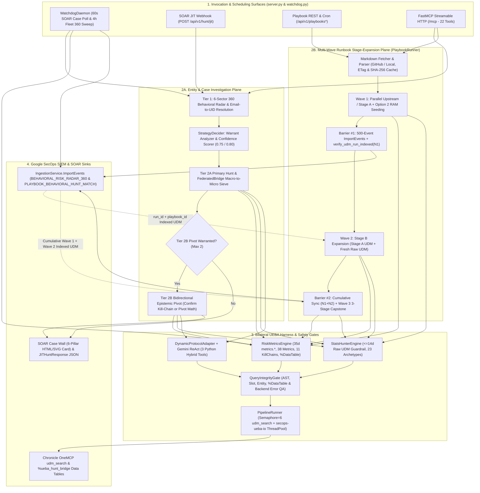

# 🏛️ Agentic UEBA System Architecture (`v2.4.0`)

Welcome to **Agentic UEBA** (`secops-agentic-hunter`). This document defines the production architecture, subsystem responsibilities, mathematical gates, multi-wave query orchestration contracts, and UDM ingestion schemas for the autonomous Google Security Operations (Chronicle SIEM & SOAR) threat hunting engine.

---

## 🧭 System Philosophy: The Bilateral Two-Tier Paradigm

`agentic-ueba` separates domain-grounded statistical detection logic (**Tier 1 Embedded Skills**) from stateful, temporal orchestration (**Tier 2 Autonomous Daemon & Multi-Wave Engine**):

```text
┌────────────────────────────────────────────────────────────────────────────────────────┐
│                       THE BILATERAL UEBA THREAT HUNTING PARADIGM                       │
│                                                                                        │
│  [ TIER 1: THE BILATERAL UEBA HARNESS — Canonical Embedded Skills ]                    │
│  • Macro Plane (secops-risk-metrics-multistage v2.2.0+):                               │
│    - 30-day metrics.* baselines across 38 Malachite metrics & 11 KillChainArchetypes   │
│    - 18 mathematical models & 34 templates (Quantile/IQR/Skew, MAD, Peer, CUSUM, 360°) │
│  • Micro / Windowed Plane (secops-statistical-hunter v2.9.0+):                         │
│    - Bounded (<= 14d) raw UDM statistical & structural models across 24 archetypes     │
│    - Tukey/Bowley Skew Fences, Markov, Shannon, C2 CV, Fano, Zipf, EWMA, Geo, PCR, Lag │
│  • Normalization Layer: Calibrated Risk Index (CRI in [0, 100], Sigmoid alpha = 0.6)   │
│                                                                                        │
│                   │ (CleanHandOffPayload / UDM Loopback / %ueba_hunt_bridge)           │
│                   ▼                                                                    │
│                                                                                        │
│  [ TIER 2: AGENTIC UEBA — Stateful Daemon, Multi-Wave Runner & SOAR Triager ]          │
│  • WatchdogDaemon: 60s SOAR Case Scanner, 4h Fleet 360° Sweep, & Playbook Scheduler    │
│  • AutonomousHunter + StrategyDecider: Confidence-gated Tier 1 -> 2A -> 2B Pivots      │
│  • FederatedBridge: Two-phase Macro (30d metrics.*) -> Micro (<= 14d raw UDM) Sieve    │
│  • PlaybookRunner: 3-Wave Stage A -> UDM -> Stage B -> Capstone Stage-Expansion Engine │
│  • QueryIntegrityGate: Pre-dispatch AST/Slot/Entity/%Table QA & Backend Error Gate     │
│  • Native Sinks: IngestionService.ImportEvents + Sanitized 6-Pillar Case Wall HTML/SVG │
└────────────────────────────────────────────────────────────────────────────────────────┘
```

---

## 🗺️ High-Level System Architecture Diagram



---

## 🧩 Core Subsystem Specifications

### Subsystem 1: Stateful Singleton Watchdog & Concurrency Governor (`src/watchdog.py`, `src/pipeline_runner.py`)
* **Role**: Coordinates continuous background loops alongside live HTTP and MCP requests inside a single stateful container instance (`--min-instances=1 --max-instances=1 --no-cpu-throttling`).
* **Responsibilities**:
  * **60s SOAR Case Scanner (`_run_loop` + `_worker_loop`)**: Polls open SOAR cases (`list_cases`), inspects raw connector telemetry (`get_connector_event`), deduplicates against `_in_flight_case_ids` and `data/watchdog_state.json`, and dispatches unseen cases to `WATCHDOG_WORKER_CONCURRENCY=3` workers.
  * **4h Fleetwide 360° Sweep (`_fleet_360_loop`)**: Runs $O(1)$ Mode A fleetwide sector queries across `USER` (6 sectors) and `ASSET` (6 sectors), enforcing intra-day escalation deduplication (`should_emit_fleet_360`: emits once per UTC day unless a new sector breaches $\ge 3.0\sigma$ or Euclidean $D$ escalates by $\ge +2.0\sigma$).
  * **Parallel Playbook Scheduler (`_playbook_loop`)**: Runs up to `SECOPS_PLAYBOOK_CONCURRENCY=6` due Markdown playbooks concurrently with per-playbook `asyncio.Lock` guards (`SKIPPED_CONCURRENT` on overlap) so playbooks sleeping at 2–22.5 minute UDM indexing barriers hold zero `udm_search` semaphore slots.
  * **Global API & Thread Isolation (`PipelineRunner`)**: Enforces a process-wide `asyncio.Semaphore` (`SECOPS_MAX_CONCURRENT_UDM_SEARCHES=6`) across every `udm_search` call and offloads synchronous `ImportEvents` uploads, Malachite AST validation, ADC OAuth refreshes, and disk state writes onto `secops-ueba-io` worker threads.

---

### Subsystem 2: Statistical Evaluator, Warrant Analyzer & Epistemic Pivot Engine (`src/risk_metrics_engine.py`, `src/stats_hunter_engine.py`, `src/strategy_decider.py`)
* **Statistical Gate & Calibrated Risk Index (CRI)**:
  * Evaluates personal 30-day drift ($Z_{\text{Self}}$), peer cohort divergence ($Z_{\text{Peer}}$), and multi-sector Euclidean threat distance $D = \sqrt{\sum \max(0, Z_i)^2}$.
  * Normalizes anomaly scores into the **Calibrated Risk Index ($\text{CRI} \in [0, 100]$)**:
    $$
    \text{CRI}(Z) = \text{round}\left(\frac{100}{1 + \exp(-0.6 \cdot (Z - 3.0))}\right)
    $$
  * Classifies outliers at $\text{CRI} \ge 46$ ($Z \ge 3.0\sigma$).
  * **Root Significance Gate (`PipelineRunner.GATE_DEFAULTS`)**: Every `secops-risk-metrics-multistage` template carries an explicit root `condition:` (`anomaly_threshold = 3.0`, `fold_change_threshold = 2.0`, `fusion_threshold_sq = 9.0` i.e. $D \ge 3.0$, `robust_threshold = 3.5`) aligned with the Python evaluator so nominal entities are filtered server-side without dropping borderline outliers.
* **Telemetry Physics & Window Guardrail**:
  * **Macro Plane (`RiskMetricsEngine`)**: Queries pre-computed `metrics.*` daily rollups over `35d` windows across all **38 Malachite catalog metrics**.
  * **Micro Plane (`StatsHunterEngine`)**: Hard-clamps raw UDM statistical queries to **`<= 14 days`** (`enforce_telemetry_physics_window`) and shifts Entity Context Graph (`DERIVED_CONTEXT` / `GLOBAL_CONTEXT`) windows back `48h` (`D-2`) when required, preventing 1M-row raw scan timeouts across all **23 canonical `secops-statistical-hunter` archetypes**.
* **Confidence-Gated Warrant & Bidirectional Epistemic Pivot (`StrategyDecider`)**:
  * **Email-to-`user.userid` Resolution (`resolve_user_identifier`)**: Resolves corporate email addresses (`*@*`, excluding GCP service accounts) to canonical UDM `user.userid` identifiers prior to `metrics.*` execution.
  * **360° Warrant Synthesis (`analyze_360_insights`)**: Extracts `$z`, `$obs`, `$avg`, and `$std` across 6 `USER` spokes (`Auth`, 4-family `Cloud` CRUD, `Workspace`, `Egress`, `DNS`, `Web`) and 6 `ASSET` spokes (`Auth`, `Egress`, `DNS`, `Flows`, `Alerts`, `Web`), flagging `subthreshold_sectors` ($1.25 \le Z < 2.0$), `variance_masked_sectors` ($1.25 \le Z < 3.0$ with $\sigma \ge \max(1.5\mu, 5.0)$), and `dormant_awakening_sectors` ($\text{obs} > 0, \mu < 1.0, Z \ge 1.5$).
  * **Evidence-Anchored Confidence Scoring (`score_hypothesis_confidence`)**: Scores candidate hypotheses on `[0.00, 1.00]` with `AUTO_EXECUTE` gates at `0.75` (Tier 2A) and `0.80` (Tier 2B pivot), zero-telemetry spoke caps (`max 0.35`), and duplicate-signature vetoes.
  * **Expanded Tier 2 Execution Portfolio (up to `MAX_SECONDARY_HUNTS = 2`)**:
    * `run_killchain_archetype()`: Executes all **11 MITRE ATT&CK `KillChainArchetype` pipelines** (`CREDENTIAL_ACCESS_TO_EXECUTION`, `INITIAL_ACCESS_TO_DISCOVERY`, `EXECUTION_TO_C2_DNS`, `EXECUTION_TO_EXFILTRATION`, `CREDENTIAL_ACCESS_TO_LATERAL_MOVEMENT`, `CLOUD_DISCOVERY_TO_COLLECTION`, `DEFENSE_EVASION_ALERT_TO_EXFILTRATION`, `C2_BEACON_TO_RARE_DESTINATION_EXFIL`, `WORKSPACE_HOARDING_TO_EGRESS`, `EXFILTRATION_OVER_WEB_SERVICE`, `RECON_TO_INITIAL_ACCESS`, plus cross-sector resource-to-execution routing).
    * `run_workspace_triad()`: 3-Stage `PART_OF_THE_WHOLE_TRIAD_MULTILEVEL` decomposing Workspace downloads, permission changes, and outbound emails against enterprise peers.
    * `run_cloud_repository_scope()`, `run_failure_ratio_surge()`, `run_alert_surge()`, and `run_data_table_bridge()` (`%ueba_hunt_bridge.<column>` persistent table joins).
    * Mathematical assumption pivots for refuted/masked Tier 2A outcomes: 4-Stage Non-Parametric `MAD`, `TWO_PART_HURDLE`, `MACD_MOMENTUM_VELOCITY`, `CIRCADIAN_VON_MISES`, and Cross-Entity `USER` $\leftrightarrow$ `ASSET`/`IP` bridges.

---

### Subsystem 3: Bilateral Sieve & Dynamic Protocol Adapter (`src/federated_bridge.py`, `src/dynamic_protocol_adapter.py`, `src/autonomous_hunter.py`)
* **`DynamicProtocolAdapter`**: Strips human-in-the-loop consultative pauses from both embedded `SKILL.md` files while preserving 100% of compiler invariants, `.yl2` templates, and domain rules; offloads bulky reference tables in favor of 3 Python Hybrid Engine tools (`compile_ueba_pipeline`, `score_cri`, `format_triage_report`); synthesizes unified Bilateral personas (`build_bilateral_jit_persona()`); and sanitizes any language implying external warehouse dependencies (`sanitize_bq_backend_references`).
* **`FederatedBridge.run_two_phase_chained_hunt()`**: Chains Macro anomalies (`CRI >= 46`) directly into targeted Micro statistical confirmation (`MARKOV_TRANSITION_RARITY` for web-to-shell/exploit chains, `C2_BEACONING_JITTER` + `POISSON_RARE_SURGE` for Shadow AI/beaconing, `POISSON_BURST_CLUSTERING` for auth/cloud surges) and computes joint Euclidean L2 risk scores (`loopback_eligible` when $Z_{\text{joint}}^2 \ge 25.0$ across $\ge 2$ planes).

---

### Subsystem 4: Multi-Wave Stage-Expansion Engine (`src/playbook_runner.py`)
Chronicle YARA-L 2.0 restricts any single multi-stage query to `SourceCount["udm"] <= 2` raw UDM stages and `<= 20` outcome variables per stage. `PlaybookRunner` expands Markdown runbooks into **4 to 6+ analytical stages** across three waves:

| Execution Wave | Role & Synchronization | Stage Expansion Mechanics |
| :--- | :--- | :--- |
| **Wave 1 (`execution_wave = 1`)** | Parallel Upstream, `Stage A`, Option 1 Piecewise, & Option 2 In-Memory Seeded (`/* UPSTREAM_CANDIDATE_* */`) | Runs up to `SECOPS_PLAYBOOK_QUERY_CONCURRENCY=3` queries in parallel; injects up to 25 RAM-extracted entities into seeded downstream queries with `0s` indexing wait; stamps matches with `metadata.product_log_id = "<run_id>"` and `security_result[0].rule_name = "<playbook_id>:<query_id>"`. |
| **Barrier #1** | Read-After-Write UDM Sync (`Wave 1 -> Wave 2`) | Flushes Wave 1 `PLAYBOOK_BEHAVIORAL_HUNT_MATCH` events in 500-event batches, clears RAM buffers, and polls `verify_udm_run_indexed()` (`45 × 30s`) until `indexed_events >= N1`. |
| **Wave 2 (`execution_wave = 2`)** | `Stage A -> UDM -> Stage B` Inline Stage Expansion (`is_udm_gated = True`) | `Stage B` (`2B`, `4B`, `6B`) reads `Stage A`'s indexed UDM output in Stage 1 (using only 1 raw UDM stage) and joins fresh raw UDM telemetry in Stage 2—achieving **4+ stages across 2 queries**. Emits findings under the same `run_id`. |
| **Barrier #2** | Cumulative UDM Sync (`Wave 2 -> Wave 3`) | Flushes Wave 2 UDM events and verifies cumulative `indexed_events >= N1 + N2` (`0s` fast-path if `N2 = 0`; blocks Capstone as `SKIPPED_INCOMPLETE_UDM_SYNC` if partial). |
| **Wave 3 (`execution_wave = 3`)** | Unified 3-Stage Capstone & Programmatic Convergence | `prepare_capstone_query()` injects `run_id` + `^<playbook_id>:` regex isolation, evaluates Euclidean L2 multi-scenario convergence ($\sum Z_i^2 \ge 25.0$ across $\ge 2$ scenarios), joins raw UDM for forensic context, and runs `converge_playbook_entities()` (`PLAYBOOK_CAPSTONE_CONVERGENCE`). |

---

### Subsystem 5: Two-Layer Query Integrity Gate (`src/query_integrity_gate.py`)
1. **Pre-Dispatch Verification (`verify_pre_dispatch`)**: Rejects empty queries, unrendered `{{placeholder}}` variables, Malachite YARA-L AST syntax errors, bare `%data_table` tokens lacking `.column_name` accessors, unscoped non-fleet single-entity queries (`UNSCOPED_ENTITY_QUERY`), and preflight-to-execution drift.
2. **Post-Execution Verification (`verify_backend_response`)**: Inspects raw Chronicle OneMCP responses for compiler/gRPC/`INVALID_ARGUMENT` errors and raises `ChronicleBackendQueryError` so broken queries never masquerade as `0.00σ` clean hunts.

---

## 📋 Data Contracts & UDM Schemas

### 1. Clean Hand-Off Payload (`CleanHandOffPayload`, Tier 1 $\rightarrow$ Tier 2 / SOAR)

```json
{
  "target_entity": "alex.lund",
  "entity_type": "USER",
  "evaluated_window": "14d",
  "primary_model": "PART_OF_THE_WHOLE_TRIAD_MULTILEVEL",
  "outlier_topology": "MULTI_SECTOR_KILLCHAIN",
  "composite_distance_d": 7.85,
  "suggested_mitre_tactics": ["TA0009", "TA0010"],
  "associated_assets": ["wks-alex-01.stackedpads.local"],
  "associated_users": ["alex.lund"]
}
```

### 2. Fleetwide 360° UDM Event (`BEHAVIORAL_RISK_RADAR_360` via `ImportEvents`)
* `metadata.event_type = "GENERIC_EVENT"`, `metadata.product_event_type = "BEHAVIORAL_RISK_RADAR_360"`.
* `security_result[0]`: Composite roll-up (`rule_type = "COMPOSITE_360"`, `risk_score = <Composite CRI>`, `severity = "CRITICAL" | "HIGH" | "MEDIUM" | "LOW"`).
* `security_result[1..N]`: Per-spoke entries (`rule_type = "SECTOR_VECTOR"`, `threat_name = "<SECTOR>"`, `risk_score = <Vector CRI>`, `confidence_score = <Vector Z>`, `threat_status = "ACTIVE" | "CLEARED"`).

### 3. Playbook Stage-Expansion & Loopback UDM Event (`PLAYBOOK_BEHAVIORAL_HUNT_MATCH` via `ImportEvents`)

```json
{
  "metadata": {
    "event_timestamp": "2026-10-28T16:00:00Z",
    "event_type": "GENERIC_EVENT",
    "product_event_type": "PLAYBOOK_BEHAVIORAL_HUNT_MATCH",
    "product_log_id": "run_shadow-ai-ueba_20261028T160000Z_a1b2c3d4",
    "vendor_name": "Google SecOps",
    "product_name": "SecOps Agentic Playbook Runner"
  },
  "principal": {
    "user": { "userid": "tim.smith" }
  },
  "target": {
    "resource": {
      "name": "PLAYBOOK_BEHAVIORAL_HUNT_MATCH",
      "attribute": {
        "labels": [
          { "key": "Playbook ID", "value": "shadow-ai-ueba" },
          { "key": "Query ID", "value": "q02_query_2a_macro_egress_stage_a" },
          { "key": "Run ID", "value": "run_shadow-ai-ueba_20261028T160000Z_a1b2c3d4" },
          { "key": "Effective Z", "value": "4.80" },
          { "key": "CRI Score", "value": "75" }
        ]
      }
    }
  },
  "security_result": [
    {
      "rule_name": "shadow-ai-ueba:q02_query_2a_macro_egress_stage_a",
      "rule_type": "PLAYBOOK_STAGE_MATCH",
      "risk_score": 75,
      "confidence_score": 4.8,
      "severity": "HIGH",
      "detection_fields": [
        { "key": "run_id", "value": "run_shadow-ai-ueba_20261028T160000Z_a1b2c3d4" },
        { "key": "playbook_id", "value": "shadow-ai-ueba" },
        { "key": "query_id", "value": "q02_query_2a_macro_egress_stage_a" },
        { "key": "unified_threat_score", "value": "4.8" }
      ]
    }
  ]
}
```

---

## 🗂️ Production Package Structure

```text
agentic_ueba/
├── README.md                           # Operational guide, diagrams, API reference, & Cloud Run sizing
├── ARCHITECTURE.md                     # System Architecture & Technical Specifications (This File)
├── LICENSE                             # Apache 2.0 License
├── Dockerfile                          # Production Python 3.13 container baking in canonical skills
├── cloudbuild.yaml                     # Cloud Build CI/CD pipeline (tests -> skill staging -> image build)
├── requirements.txt                    # Production Python dependencies
├── data/
│   └── watchdog_state.json             # Persistent ledger for triaged cases, playbooks, & UDM dedup state
├── scripts/
│   └── build_container.sh              # Stages canonical skills into .build/skills for container packaging
├── src/
│   ├── __init__.py
│   ├── _bootstrap.py                   # Runtime path & virtualenv bootstrapper
│   ├── config.py                       # Multi-tenant configuration & ADC Bearer token generator
│   ├── models.py                       # Pydantic schemas (JITHuntRequest, JITHuntResponse, CleanHandOffPayload)
│   ├── server.py                       # Dual FastMCP (22 tools on /mcp) + Starlette REST Gateway (14 routes)
│   ├── autonomous_hunter.py            # 3-Stage investigation orchestrator, Bilateral mode, & Gemini ReAct loop
│   ├── strategy_decider.py             # 360° warrant analyzer, confidence scorer, & Tier 2A -> Tier 2B pivot router
│   ├── risk_metrics_engine.py          # 30d UEBA engine (38 metrics, 11 KillChains, %DataTable bridge, Fleet 360°)
│   ├── stats_hunter_engine.py          # Bounded <=14d raw UDM engine (23 archetypes: C2 CV, Fano, Shannon, Markov, Zipf, EWMA, Geo, PCR)
│   ├── playbook_runner.py              # 3-Wave Markdown playbook engine (Stage A -> UDM -> Stage B -> Capstone & ETag cache)
│   ├── pipeline_runner.py              # Template renderer, Malachite AST bridge, global udm_search governor, & IO thread pool
│   ├── query_integrity_gate.py         # Pre-dispatch AST/entity/slot/Data-Table validator & post-execution backend error gate
│   ├── dynamic_protocol_adapter.py     # Runtime SKILL.md protocol adapter, Bilateral persona builder, & BQ sanitizer
│   ├── federated_bridge.py             # Two-phase Macro (30d metrics.*) -> Micro (<=14d raw UDM) handoff sieve
│   ├── watchdog.py                     # Standing case scanner, worker pool, 4h Fleet 360° & parallel playbook scheduler
│   └── formatters/
│       ├── __init__.py
│       └── case_wall_card.py           # Chronicle SOAR Case Wall 6-pillar HTML/SVG card formatter & sanitizer
└── tests/                              # Automated Unit & Schema Contract Test Suite (94 tests)
    ├── test_engines.py
    ├── test_metric_args.py
    ├── test_playbook_runner.py
    ├── test_protocol_adapter.py
    └── test_watchdog.py
```

---

## 📜 License
This project is licensed under the [Apache License 2.0](LICENSE).
```
Copyright 2026 Google LLC

Licensed under the Apache License, Version 2.0 (the "License");
you may not use this file except in compliance with the License.
You may obtain a copy of the License at

    http://www.apache.org/licenses/LICENSE-2.0
```

---
*Created and maintained by Greg Kushmerek for Google Security Operations (Chronicle SIEM & SOAR).*
