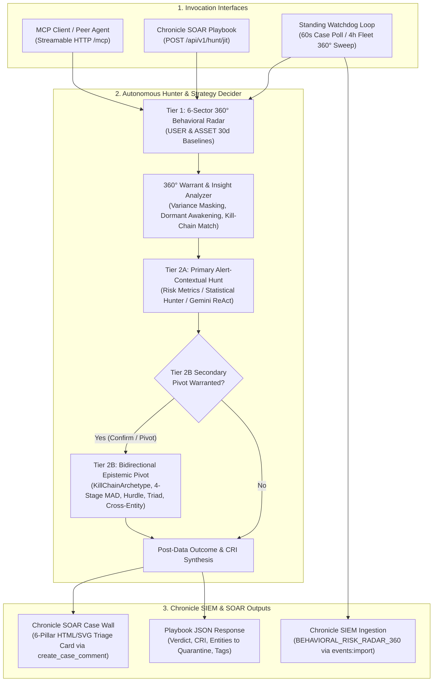

# 🛡️ Agentic UEBA: Autonomous SecOps Threat Hunter & 360° Behavioral Risk Radar

[](README.md) [](LICENSE) [-brightgreen.svg)](tests/)

**Agentic UEBA** (`secops-agentic-hunter`) is an autonomous, dual-interface threat hunting and behavioral risk service for **Google Security Operations (Chronicle SIEM & SOAR)**. It embeds the canonical **`secops-risk-metrics-multistage`** (`v2.1.0+`) and **`secops-statistical-hunter`** (`v2.8.0+`) skills to provide continuous tenant-wide behavioral baselining, automated SOAR case triage with 6-pillar HTML/SVG Case Wall reporting, and Just-In-Time (JIT) playbook and MCP execution.

---

## 🚀 Core Capabilities & Operational Modes

`agentic-ueba` operates across four integrated workflows:

### 1. Standing Fleetwide 360° Behavioral Risk Radar & UDM Event Ingestor
Every **4 hours** (`FLEET_360_INTERVAL_SECONDS=14400`), `WatchdogDaemon` executes a deterministic **Mode A** (today's UTC bucket vs. 30-day baseline) fleetwide sweep across the tenant's entire `USER` and `ASSET` populations via `RiskMetricsEngine.run_fleet_360_sweep()`:
* **$O(1)$ Fleetwide Query Complexity**: Evaluates all entities in 6 decoupled multi-stage YARA-L 2.0 sector queries per entity type:
  * **`USER` Sectors (6)**: `Auth`, `Cloud` (4-family CRUD across read/write/create/delete), `Workspace`, `Egress`, `DNS`, and `Web`.
  * **`ASSET` Sectors (6)**: `Auth`, `Egress`, `DNS`, `Web`, `Flows`, and `Alerts`.
* **Euclidean Threat Distance & Calibrated Risk Index (CRI)**: Computes multi-sector Euclidean distance $D = \sqrt{\sum \max(0, Z_i)^2}$ and Sigmoid-normalized $\text{CRI} \in [0, 100]$.
* **Intra-Day Deduplication (`WatchdogState.should_emit_fleet_360`)**: Tracks emitted `(bucket_date, entity_type, entity_id)` tuples in `data/watchdog_state.json`. An outlier entity ($\ge 1$ sector with $Z \ge 3.0\sigma$) is emitted at most once per UTC day unless:
  1. A **new behavioral sector** breaches $\ge 3.0\sigma$ later in the day, or
  2. Its composite Euclidean distance $D$ **escalates by $\ge +2.0\sigma$**.
* **Native Chronicle UDM Ingestion (`BEHAVIORAL_RISK_RADAR_360`)**: Builds one structured UDM event per outlier entity (`RiskMetricsEngine.build_360_outlier_udm_event()`) and ingests it directly into Chronicle via `IngestionService.ImportEvents` (`scripts.chronicle_ingest.import_events`):
  * **Unbundled Roll-Up Labels (`target.resource.attribute.labels`)**: `Hunt Campaign ID`, `Evaluated Day`, `Composite CRI`, `Composite D`, `Peak Vector`, `Peak CRI`, `Peak Z`, and `Breached Vectors`.
  * **Composite Roll-Up (`security_result[0]`)**: `rule_type = "COMPOSITE_360"`, `risk_score = <Composite CRI>`, `severity = "CRITICAL" | "HIGH" | "MEDIUM" | "LOW"`.
  * **Per-Vector Entries (`security_result[1..N]`)**: One `rule_type = "SECTOR_VECTOR"` entry per non-zero vector sorted descending by $Z$-score, with `threat_name = "<SECTOR>"`, native integer `risk_score = <Vector CRI>`, native float `confidence_score = <Vector Z>`, and `threat_status = "ACTIVE" | "CLEARED"`—enabling direct numeric YARA-L 2.0 rules and SIEM dashboards without regex or string parsing.

---

### 2. Autonomous SOAR Case Scanner, 3-Stage Investigation & Case Wall Triager
Every **60 seconds** (`WATCHDOG_INTERVAL_SECONDS=60`), `WatchdogDaemon` polls open Chronicle SOAR cases (`list_cases`), filters out previously triaged cases via `WatchdogState`, extracts the primary entity (`USER`, `ASSET`, or `IP`) from raw alert connector telemetry (`get_connector_event`), and dispatches unseen cases to a bounded async worker pool (`WATCHDOG_WORKER_CONCURRENCY=3`):
* **Stage 1 — Tier 1 360° Behavioral Risk Radar**: Profiles the entity across all 6 behavioral sectors over a 14-day window (`run_360_behavioral_radar()`), extracting per-sector `$z`, `$obs`, `$avg`, and `$std`. Automatically resolves corporate email addresses (`*@*`, excluding GCP service accounts) to their canonical UDM `user.userid`.
* **Stage 2 — Warrant & Insight Synthesis (`StrategyDecider.analyze_360_insights`)**: Synthesizes active spikes ($Z \ge 2.0$), sub-threshold sectors ($1.25 \le Z < 2.0$), variance-masked sectors ($1.25 \le Z < 3.0$ where $\sigma \ge \max(1.5\mu, 5.0)$), dormant baseline awakenings ($\text{obs} > 0, \mu < 1.0, Z \ge 1.5$), matched MITRE ATT&CK `KillChainArchetype` topologies, and cross-entity bridges (`USER` $\leftrightarrow$ `ASSET`/`IP`).
* **Stage 3 — Tier 2A Primary Hunt & Tier 2B Bidirectional Epistemic Pivot**:
  * **Tier 2A (Alert-Contextual Deep Dive)**: Executes the mathematical model best suited to the triggering alert and 360° radar topology (or runs a bounded Gemini ReAct loop for open-ended hypotheses).
  * **Tier 2B (Agent-Guided Secondary UEBA Investigation)**: When warranted by the 360° radar insights or Tier 2A outcome (`ACUTE_OUTLIER`, `CLEAN_OR_SUBTHRESHOLD`, `SPARSE_BASELINE`, `FLEET_WAVE`), automatically pivots to a second-order investigation:
    * *Confirmed Outliers (`ACUTE_OUTLIER`)* $\rightarrow$ Pivots to kill-chain progression (`KillChainArchetype` multi-stage fusion across 8 MITRE ATT&CK chains, Workspace 3-Stage Triad decomposition, Cloud Repository Scope & caller IP attribution, or Rare Destination Entity Context Graph enrichment).
    * *Refuted / Masked Hypotheses (`CLEAN_OR_SUBTHRESHOLD` / `SPARSE_BASELINE`)* $\rightarrow$ Pivots across mathematical assumptions (4-Stage Non-Parametric `MAD` for heavy-tailed variance masking, `TWO_PART_HURDLE` for dormant baseline awakenings, Cloud `fail`-mode access-denied recon, `MACD_MOMENTUM_VELOCITY`, `CIRCADIAN_VON_MISES`, or Cross-Entity `USER` $\leftrightarrow$ `ASSET` bridges).
* **Case Wall Injection (`CaseWallCardFormatter`)**: Renders a sanitized, SOAR-compatible HTML/SVG 6-pillar forensic triage card and posts it directly to the Chronicle SOAR Case Wall via `create_case_comment`.

---

### 3. Chronicle SOAR Playbook Gateway (REST Webhook)
Chronicle SOAR Playbooks can invoke `agentic-ueba` synchronously via a standard **HTTP Request** action block against `POST /api/v1/hunt/jit`:
* Executes the full 3-stage investigation for the target entity and case.
* Posts the HTML/SVG forensic triage card to the Case Wall (when `post_to_case_wall: true`).
* Records the case in `WatchdogState` so the standing background scanner does not duplicate the triage.
* Returns a machine-readable `JITHuntResponse` JSON payload (`triage.verdict`, `triage.calibrated_risk_index`, `triage.recommended_action`, `triage.entities_to_quarantine`, `triage.tags`, and `clean_hand_off`) for downstream playbook conditional branching and automated containment.

---

### 4. Model Context Protocol (FastMCP Server)
Exposes `/mcp` (Streamable HTTP / SSE) with **18 MCP tools** for Agent-to-Agent (A2A) orchestration, Gemini CLI / IDE integration, and interactive analyst workflows.

---

## 🏗️ Architecture & Execution Flow



---

## 🔌 How to Invoke `agentic-ueba`

### A. REST API Endpoints

#### 1. SOAR Playbook JIT Investigation (`POST /api/v1/hunt/jit`)
```bash
curl -X POST "https://<YOUR_SERVICE_URL>/api/v1/hunt/jit" \
  -H "Content-Type: application/json" \
  -d '{
    "target_entity": "alex.lund@stackedpads.local",
    "entity_type": "USER",
    "case_id": "40192",
    "alert_name": "Suspicious Google Drive Download Volume",
    "alert_description": "User downloaded an anomalous volume of sensitive files from Workspace Drive.",
    "skill": "auto",
    "lookback_days": 14,
    "post_to_case_wall": true
  }'
```

**Response Structure (`JITHuntResponse`)**:
```json
{
  "status": "SUCCESS",
  "case_wall_updated": true,
  "triage": {
    "calibrated_risk_index": 95.0,
    "verdict": "CRITICAL",
    "is_outlier": true,
    "primary_vector": "tier2b:PART_OF_THE_WHOLE_TRIAD_MULTILEVEL",
    "common_vector": "WORKSPACE",
    "second_order_ran": true,
    "tags": ["RISK:CRITICAL", "VECTOR:WORKSPACE", "SECOND_ORDER_HUNT"],
    "top_z_score": 7.85,
    "recommended_action": "QUARANTINE_AND_ESCALATE",
    "entities_to_quarantine": ["alex.lund"],
    "mitre_tactics": ["TA0009", "TA0010"]
  },
  "clean_hand_off": {
    "target_entity": "alex.lund",
    "entity_type": "USER",
    "evaluated_window": "14d",
    "primary_model": "PART_OF_THE_WHOLE_TRIAD_MULTILEVEL",
    "outlier_topology": "MULTI_SECTOR_KILLCHAIN"
  }
}
```

#### 2. On-Demand or Backfill Fleetwide 360° Sweep (`POST /api/v1/radar/fleet-sweep`)
```bash
curl -X POST "https://<YOUR_SERVICE_URL>/api/v1/radar/fleet-sweep" \
  -H "Content-Type: application/json" \
  -d '{
    "entity_types": ["USER", "ASSET"],
    "spike_threshold_z": 3.0,
    "spoke_inclusion_z": 2.0,
    "min_observed": 5,
    "lookback_days": 1,
    "ingest_events": true
  }'
```

#### 3. Watchdog Control & Case Activity Ledger
| Method | Path | Description |
| :--- | :--- | :--- |
| `GET` | `/healthz` | Cloud Run liveness/readiness check (reports default tenant & watchdog state). |
| `GET` | `/api/v1/watchdog/status` | Returns runtime status, queue depth, active workers, and recent 360° sweep stats. |
| `POST` | `/api/v1/watchdog/start` | Starts the background case-polling loop, worker pool, and 4h fleet 360° scheduler. |
| `POST` | `/api/v1/watchdog/stop` | Cleanly cancels background polling and worker tasks. |
| `POST` | `/api/v1/watchdog/reset-state` | Clears seen cases and intra-day 360° deduplication state in `data/watchdog_state.json`. |
| `POST` | `/api/v1/cases/scan` | Triggers an immediate single scan pass over open SOAR cases (`{"limit": 5}`). |
| `GET` | `/api/v1/cases/activity` | Returns triaged case ledger filtered by `?timeframe=24h` (`1h`, `24h`, `7d`, `all`) and optional `?tag=RISK:CRITICAL,SECOND_ORDER_HUNT`. |

---

### B. MCP Tools (`/mcp`)

Connect any MCP client (Streamable HTTP) to `https://<YOUR_SERVICE_URL>/mcp`. Available tools:

| Category | Tool Name | Purpose |
| :--- | :--- | :--- |
| **Core Orchestration** | `hunt_entity` | Full 3-stage autonomous JIT threat hunt for a `USER`, `ASSET`, or `IP`. |
| | `profile_360_risk` | Decoupled 6-sector 360° behavioral risk radar profile for an entity. |
| | `run_fleet_360_sweep` | Runs the Mode A fleetwide 360° sweep and ingests `BEHAVIORAL_RISK_RADAR_360` UDM events. |
| | `scan_open_cases` | Scans open Chronicle SOAR cases and executes autonomous hunts. |
| | `control_watchdog` | Starts, stops, resets, or queries the background `WatchdogDaemon`. |
| | `get_case_activity` | Queries the triaged case ledger by `timeframe` and `tag`. |
| **Hybrid Compiler** | `compile_hunt_pipeline` | Compiles an AST-validated multi-stage YARA-L 2.0 query, Pre-Flight card, and 1-shot probe. |
| | `dispatch_hybrid_handoff` | Dispatches a federated `secops-threat-hunt-handoff-v1` payload to `secops-statistical-hunter`. |
| **Specialized Hunters** | `hunt_cloud_crud` | 30-day baseline Cloud CRUD write surge with companion dimensions. |
| | `hunt_hybrid_enrichment` | Dual-Plane 2-stage macro-baseline + micro-telemetry signature fusion. |
| | `hunt_circadian_von_mises` | Off-hours temporal anomaly detection using a 24-hour circular von Mises clock. |
| | `hunt_macd_momentum` | Instantaneous momentum velocity divergence (`7d` vs. `30d` anchor). |
| | `hunt_c2_jitter` | Robotic C2 beaconing detection via inter-arrival Coefficient of Variation ($CV \le 0.20$). |
| | `hunt_poisson_burst` | Credential spray burst clustering via Poisson Fano Factor dispersion ($F > 4.0$). |
| | `hunt_shannon_entropy` | Obfuscated command line / DGA detection via Shannon character-class entropy. |
| | `hunt_markov_transition` | Rare Living-off-the-Land parent$\rightarrow$child process transitions via Markov 2-gram surprisal. |
| | `hunt_zipfian_rarity` | Rare administrative binary execution in the enterprise Zipfian power-law tail. |
| | `hunt_ewma_burst` | Acute intraday kinetic rate surges via EWMA velocity divergence. |

---

## ☁️ Hosting, Sizing & Scaling Guidelines (Cloud Run / Container)

> [!IMPORTANT]
> **`agentic-ueba` is a stateful singleton daemon and MUST NOT be horizontally scaled (`--min-instances=1 --max-instances=1`).**

### Why Horizontal Scaling (`max-instances > 1`) Must Be Disabled
1. **In-Process Concurrency Locks & Local Deduplication Ledger**:
   `WatchdogDaemon` uses in-memory `asyncio.Lock` guards (`_scan_lock`, `_fleet_360_lock`), an in-memory `_in_flight_case_ids` set, and a local atomic JSON ledger (`data/watchdog_state.json`) to track seen SOAR cases and intra-day `BEHAVIORAL_RISK_RADAR_360` UDM emissions. Running multiple container instances would cause replicas to race on the same open SOAR cases (posting duplicate comments to the Case Wall) and ingest duplicate `BEHAVIORAL_RISK_RADAR_360` UDM events into Chronicle.
2. **Chronicle API Quota & Rate-Limit Protection**:
   Both the 4-hour fleetwide 360° sweep (`FLEET_360_INTER_QUERY_DELAY_SEC=1.5`) and the bounded case worker pool (`WATCHDOG_WORKER_CONCURRENCY=3`) are paced to respect Chronicle OneMCP `udm_search` QPS limits. Horizontal replicas multiply query concurrency against the same Chronicle tenant.
3. **Background Scheduler Continuity (`--no-cpu-throttling`)**:
   On Google Cloud Run, if CPU is only allocated during HTTP requests, Cloud Run freezes background `asyncio` tasks (`_run_loop`, `_worker_loop`, and `_fleet_360_loop`) as soon as an HTTP response finishes. You **must** deploy with **CPU always allocated** (`--no-cpu-throttling`) and **`--min-instances=1`**.

### Recommended Compute Resources
| Resource / Setting | Recommended Value | Rationale |
| :--- | :--- | :--- |
| **Instances** | `min-instances=1`, `max-instances=1` | Strict singleton to preserve deduplication state and prevent duplicate Case Wall / UDM writes. |
| **CPU Allocation** | `2 vCPU` (`--cpu=2`) | Handles concurrent async HTTP/MCP streams, AST validation, and SVG/HTML rendering without contention. |
| **CPU Throttling** | **Always-On** (`--no-cpu-throttling`) | Required so standing 60s case scans and 4h fleet 360° sweeps execute continuously in the background. |
| **Memory** | `2 GiB` (`--memory=2Gi`) | Ample headroom for Python 3.13, embedded skill catalogs, columnar stats parsing, and sliding-window state. |
| **Uvicorn Workers** | `1` (Default in `Dockerfile`) | Single-process async event loop so all routes share the same `WatchdogDaemon` locks and state. |
| **Request Timeout** | `300s` (`--timeout=300`) | Accommodates multi-stage 360° + Tier 2A + Tier 2B synchronous SOAR Playbook investigations. |

### Example Cloud Run Deployment Command
```bash
# 1. Stage canonical skills into .build/skills and build via Cloud Build
gcloud builds submit --config cloudbuild.yaml .

# 2. Deploy as an always-on singleton service
gcloud run deploy secops-agentic-hunter \
  --image "gcr.io/${PROJECT_ID}/secops-agentic-hunter:latest" \
  --region us-central1 \
  --platform managed \
  --min-instances=1 \
  --max-instances=1 \
  --cpu=2 \
  --memory=2Gi \
  --no-cpu-throttling \
  --timeout=300 \
  --concurrency=20 \
  --set-env-vars="CHRONICLE_PROJECT_ID=gus-sdl,CHRONICLE_CUSTOMER_ID=8cbac5ae-8267-4da7-b405-cdbc6fa3f1d5,CHRONICLE_REGION=us,WATCHDOG_ENABLED=true,FLEET_360_ENABLED=true"
```

---

## ⚙️ Environment Variables Reference

| Variable | Default | Description |
| :--- | :--- | :--- |
| `CHRONICLE_PROJECT_ID` | `gus-sdl` | GCP Project ID bound to the Chronicle tenant. |
| `CHRONICLE_CUSTOMER_ID` | `8cbac5ae-...` | Chronicle Customer UUID. |
| `CHRONICLE_REGION` | `us` | Chronicle regional endpoint (`us`, `eu`, `asia-southeast1`, etc.). |
| `CHRONICLE_MCP_URL` | *(auto-resolved)* | Optional override for `https://chronicle.<region>.rep.googleapis.com/mcp`. |
| `GEMINI_MODEL` | `gemini-3.1-pro-preview` | Primary Vertex AI Gemini model for ReAct synthesis. |
| `GEMINI_FALLBACK_MODELS` | `gemini-3-flash-preview,gemini-2.5-pro,gemini-2.5-flash` | Ordered fallback models on quota/availability errors. |
| `WATCHDOG_ENABLED` | `false` | Auto-starts the standing case scanner and fleet 360° loop on startup when `true`. |
| `WATCHDOG_INTERVAL_SECONDS` | `60` | Polling interval (seconds) for open Chronicle SOAR cases. |
| `WATCHDOG_LIMIT_PER_SCAN` | `5` | Maximum unseen cases enqueued per scan pass. |
| `WATCHDOG_SCAN_LOOKBACK_HOURS` | `4` | Sliding creation-time horizon (hours) when querying open SOAR cases. |
| `WATCHDOG_WORKER_CONCURRENCY` | `3` | Number of parallel async case-investigation workers. |
| `FLEET_360_ENABLED` | `false` | Enables the background 4-hour Mode A fleetwide 360° radar sweep when `WatchdogDaemon` runs. |
| `FLEET_360_INTERVAL_SECONDS` | `14400` | Interval (seconds) between fleetwide 360° sweeps (`14400` = 4 hours). |
| `FLEET_360_SPIKE_THRESHOLD_Z` | `3.0` | Minimum single-sector $Z$-score required to classify an entity as a 360° outlier. |
| `FLEET_360_SPOKE_INCLUSION_Z` | `2.0` | Minimum $Z$-score floor for populating secondary sectors on the entity's 360° profile. |
| `FLEET_360_MIN_OBSERVED` | `5` | Minimum observed event count per sector to suppress low-volume noise. |
| `FLEET_360_MAX_OUTLIERS_PER_SECTOR` | `250` | Macro-rollout circuit breaker cap per sector (skips noisy fleet waves). |
| `FLEET_360_INGEST_EVENTS` | `true` | When `true`, ingests `BEHAVIORAL_RISK_RADAR_360` UDM events via `events:import`. |
| `SKILLS_ROOT` | `/app/skills` | Directory containing `secops-risk-metrics-multistage` and `secops-statistical-hunter` (auto-falls back to `~/projects/` or `~/.gemini/skills/` locally). |

---

## 📂 Repository Structure

```text
agentic_ueba/
├── README.md                           # Operational guide, API reference, & Cloud Run hosting instructions
├── ARCHITECTURE.md                     # Deep-dive system architecture, data contracts, & mathematical models
├── LICENSE                             # Apache 2.0 License
├── Dockerfile                          # Production Python 3.13 container baking in canonical skills
├── cloudbuild.yaml                     # Cloud Build CI/CD pipeline (tests -> skill staging -> image build)
├── requirements.txt                    # Runtime Python dependencies
├── data/
│   └── watchdog_state.json             # Persistent ledger for triaged cases & intra-day 360° emissions
├── scripts/
│   └── build_container.sh              # Stages canonical skills into .build/skills for container packaging
├── src/
│   ├── __init__.py
│   ├── _bootstrap.py                   # Runtime path & virtualenv bootstrapper
│   ├── config.py                       # Multi-tenant configuration & ADC Bearer token generator
│   ├── models.py                       # Pydantic schemas (JITHuntRequest, JITHuntResponse, CleanHandOffPayload)
│   ├── server.py                       # Dual FastMCP (/mcp) + Starlette REST Gateway (/api/v1/*)
│   ├── autonomous_hunter.py            # 3-Stage investigation orchestrator + Gemini ReAct loop
│   ├── strategy_decider.py             # 360° warrant analyzer & Tier 2A -> Tier 2B epistemic pivot router
│   ├── risk_metrics_engine.py          # 30d UEBA engine, Fleet 360° sweep, & BEHAVIORAL_RISK_RADAR_360 ingestor
│   ├── stats_hunter_engine.py          # Inline raw-log statistical engine (C2 CV, Fano, Shannon, Markov, Zipf, EWMA, Impossible Travel, Producer-Consumer)
│   ├── pipeline_runner.py              # Template renderer, Malachite AST validator, Data Table bridge, & hybrid engine bridge
│   ├── query_integrity_gate.py         # Pre-dispatch AST/entity/slot/Data-Table validator & post-execution backend error gate
│   ├── dynamic_protocol_adapter.py     # Runtime SKILL.md protocol adapter with reference offloading
│   ├── federated_bridge.py             # Cross-skill Macro-to-Micro handoff bridge
│   ├── watchdog.py                     # Standing case scanner, worker pool, & 4-hour Fleet 360° scheduler
│   └── formatters/
│       ├── __init__.py
│       └── case_wall_card.py           # Chronicle SOAR Case Wall HTML/SVG card formatter & sanitizer
└── tests/                              # Unit & contract test suite (69 tests)
    ├── test_engines.py
    ├── test_metric_args.py
    ├── test_protocol_adapter.py
    └── test_watchdog.py
```

---

## 🧪 Local Development & Testing

```bash
# Run the full 69-test unit and schema contract suite
pytest tests/ -q

# Start the server locally on port 8080
uvicorn src.server:app --host 0.0.0.0 --port 8080
```

---

## 📜 License
This project is licensed under the [Apache License 2.0](LICENSE).
```
Copyright 2026 Google LLC

Licensed under the Apache License, Version 2.0 (the "License");
you may not use this file except in compliance with the License.
You may obtain a copy of the License at

    http://www.apache.org/licenses/LICENSE-2.0
```

---
*Created and maintained by Greg Kushmerek for Google Security Operations (Chronicle SIEM & SOAR).*
