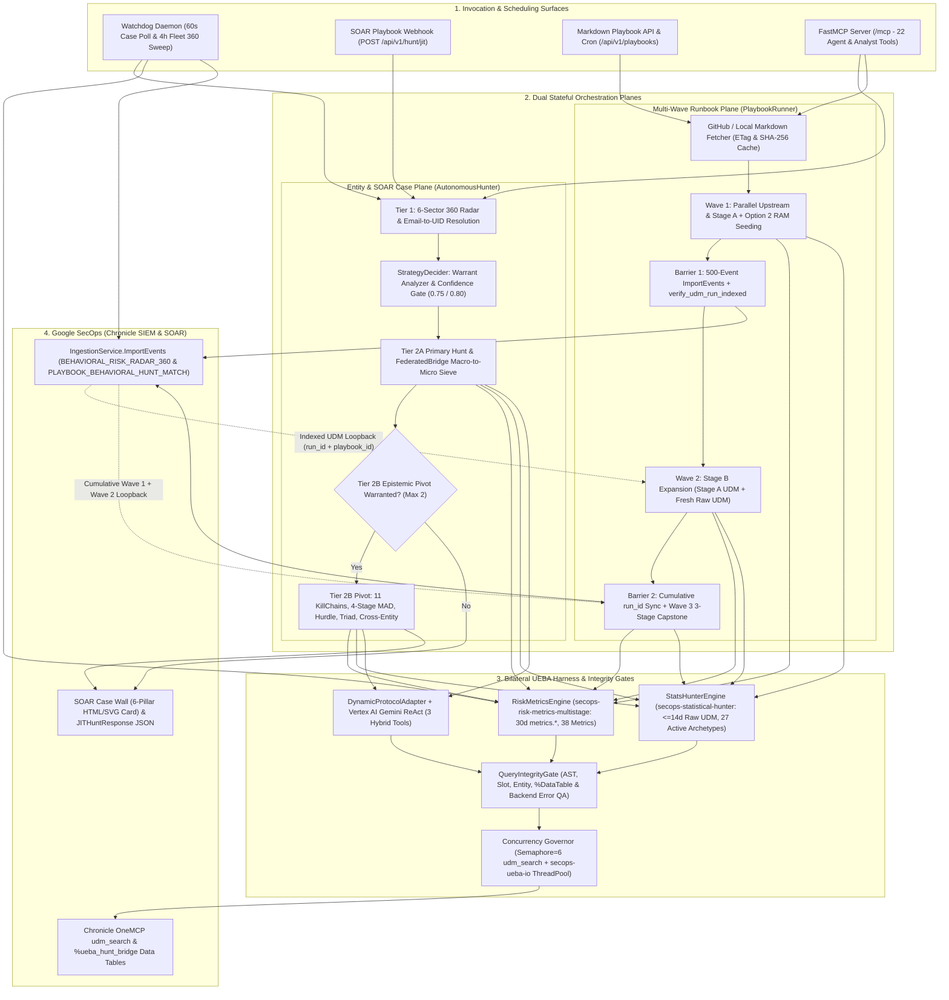
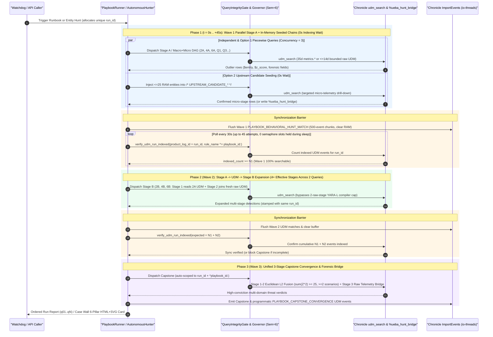

# 🛡️ Agentic UEBA: Autonomous SecOps Threat Hunter, 360° Behavioral Risk Radar & Multi-Wave Stage-Expansion Engine

[](README.md) [](LICENSE) [-brightgreen.svg)](tests/)

**Agentic UEBA** (`secops-agentic-hunter`) is an autonomous, dual-interface threat hunting, behavioral baselining, and **multi-wave query orchestration service** for **Google Security Operations (Chronicle SIEM & SOAR)**.

It embeds the canonical **`secops-risk-metrics-multistage`** (`v2.2.0+`) and **`secops-statistical-hunter`** (`v2.9.0+`) skills as a unified **Bilateral UEBA Harness**, acting as the stateful connective tissue across time:
* **Macro + Micro Multi-Horizon Fusion**: Combines 30-day pre-computed `metrics.*` baselines (38 Malachite catalog metrics, 18 mathematical models, 34 pipeline templates including 1-Stage Empirical Quantiles `window.percentile` / Bowley Quartile Skewness / Hubert–Vandervieren Skewness-Adjusted Tukey Fences, and 11 MITRE ATT&CK kill-chain archetypes) with bounded (`<= 14d`) raw-telemetry statistical and structural models (27 active canonical raw UDM archetypes across 14 statistical deformations including Non-Parametric Quantiles/Tukey Skew Fences, Per-Flow $P_{50}/P_{90}$ Tail Shape, Telemetry Ingestion-Lag Quantile Auditing, Markov 2-gram process lineage, Shannon character entropy, C2 beaconing jitter, Poisson/Fano burst dispersion, Zipfian binary rarity, EWMA burst velocity, and producer-consumer byte inversion; geodesic impossible travel is retired).
* **Multi-Wave Search Stage Expansion (`Stage A -> UDM -> Stage B -> Capstone`)**: Overcomes Chronicle YARA-L 2.0's single-query compiler ceiling (`<= 2` raw UDM event stages and `<= 20` outcome variables per stage) by chaining searches across **in-memory entity seeding**, **SecOps Data Tables (`%ueba_hunt_bridge`)**, and **read-after-write verified UDM loopback barriers (`PLAYBOOK_BEHAVIORAL_HUNT_MATCH`)**—expanding complex threat runbooks into **4 to 6+ effective analytical stages** over time.
* **Autonomous SOAR Triage & Dual Control Plane**: Continuously sweeps fleetwide `USER` and `ASSET` populations (`BEHAVIORAL_RISK_RADAR_360`), triages open SOAR cases with sanitized 6-pillar HTML/SVG Case Wall cards, and exposes **14 HTTP REST endpoints** alongside **23 Model Context Protocol (`/mcp`) tools**.

---

## 🚀 Core Capabilities & Operational Modes

`agentic-ueba` operates across five integrated workflows backed by shared execution and integrity guardrails:

### 1. Standing Fleetwide 360° Behavioral Risk Radar & UDM Event Ingestor
Every **4 hours** (`FLEET_360_INTERVAL_SECONDS=14400`), `WatchdogDaemon` executes a deterministic **Mode A** (the last complete UTC day D, `[D, D+1)`, vs. its 30-day baseline) fleetwide sweep across the tenant's entire `USER` and `ASSET` populations via `RiskMetricsEngine.run_fleet_360_sweep()`:
* **`O(1)` Fleetwide Query Complexity**: Evaluates all entities in 6 decoupled multi-stage YARA-L 2.0 sector queries per entity type:
  * **`USER` Sectors (6)**: `Auth`, `Cloud` (4-family CRUD across read/write/create/delete), `Workspace`, `Egress`, `DNS`, and `Web`.
  * **`ASSET` Sectors (6)**: `Auth`, `Egress`, `DNS`, `Web`, `Flows`, and `Alerts`.
* **Euclidean Threat Distance & Calibrated Risk Index (CRI)**: Computes multi-sector Euclidean distance $D = \sqrt{\sum \max(0, Z_i)^2}$ and the harness $\text{CRI} \in [0, 100]$ (see *Harness Truth & Calibrated Risk Index* below).
* **Intra-Day Escalation Deduplication (`WatchdogState.should_emit_fleet_360`)**: Tracks emitted `(bucket_date, entity_type, entity_id)` tuples in `data/watchdog_state.json`. An outlier entity ($\ge 1$ sector with $Z \ge$ `FLEET_360_SPIKE_THRESHOLD_Z`, by default the harness BALANCED anomaly threshold of $3.0\sigma$) is emitted at most once per UTC day unless:
  1. A **new behavioral sector** breaches the spike threshold later in the day, or
  2. Its composite Euclidean distance $D$ **reaches a higher harness CRI band**.
* **Native Chronicle UDM Ingestion (`BEHAVIORAL_RISK_RADAR_360`)**: Emits one structured UDM event per outlier entity (`RiskMetricsEngine.build_360_outlier_udm_event()`) into Chronicle via `IngestionService.ImportEvents`:
  * **Unbundled Roll-Up Labels (`target.resource.attribute.labels`)**: `Hunt Campaign ID`, `Evaluated Day`, `Composite CRI`, `Composite D`, `Peak Vector`, `Peak CRI`, `Peak Z`, and `Breached Vectors`.
  * **Composite Roll-Up (`security_result[0]`)**: `rule_type = "COMPOSITE_360"`, `risk_score = <Composite CRI>`, `severity = "CRITICAL" | "HIGH" | "MEDIUM" | "LOW"`.
  * **Per-Vector Entries (`security_result[1..N]`)**: One `rule_type = "SECTOR_VECTOR"` entry per non-zero vector sorted descending by $Z$-score, with `threat_name = "<SECTOR>"`, native integer `risk_score = <Vector CRI>`, native float `confidence_score = <Vector Z>`, and `threat_status = "ACTIVE" | "CLEARED"`—enabling direct numeric YARA-L 2.0 rules and SIEM dashboards without regex parsing.

---

### 2. Multi-Wave Markdown Hunting Playbooks & `A -> UDM -> B -> Capstone` Stage Expansion (`PlaybookRunner`)
Chronicle YARA-L 2.0 enforces a strict compiler cap of **at most 2 raw UDM event stages per query** (`SourceCount["udm"] <= 2`) and **at most 20 outcome variables per stage**. Sophisticated threat runbooks—such as Shadow AI & Agentic Tooling, Insider Risk + Chrome DLP, Web-to-Shell exploit chains (`php2shell`), and the 12 UEBA Curated Detection packs (15 playbooks / 215+ multi-stage queries in `GooGKush/docs`)—often require **4 to 6+ analytical stages** spanning 30-day baselines, sub-hour timing dispersion, DLP/process pivots, cross-scenario fusion, and raw forensic event decoration.

`PlaybookRunner` parses Markdown runbooks directly from GitHub (`blob`/`raw` URLs, local `file://` paths, or batch discovery via `PlaybookRunner.discover_repo_markdown_urls()`), caches Markdown content using HTTP `ETag` (`If-None-Match` $\rightarrow$ `304 Not Modified`) and SHA-256 digests with offline fallback, AST-validates every `stage` query, and executes runbooks across **three complementary multi-query chaining modes**:
* **Option 1 — In-DAG Piecewise Unification (`0s` indexing wait)**: Joins a cold-start (`1d–7d`) raw telemetry stage with a mature (`8d–30d`) pre-computed `metrics.*` stage inside a single YARA-L 2.0 DAG when raw UDM stage count remains $\le 2$.
* **Option 2 — In-Memory Upstream Candidate Seeding (`0s` indexing wait)**: Extracts anomalous `IP`, `USER`, `HOST`, or `SA` entities from upstream Query $N$ in memory and injects up to 25 literal candidates directly into downstream `/* UPSTREAM_CANDIDATE_IPS */` (`USERS`, `HOSTS`, `SAS`, `ENTITIES`) filter slots—chaining queries immediately without waiting for UDM ingestion.
* **Option 3 — 3-Wave Cyclical UDM Loopback (`Stage A -> UDM -> Stage B -> Capstone`, `2–22.5m` async barriers)**:
  * **Wave 1 (`execution_wave = 1`, Upstream & `Stage A` Queries)**: Independent and Option 1/2 queries execute in parallel waves (`SECOPS_PLAYBOOK_QUERY_CONCURRENCY=3`). Matched outliers are staged as `PLAYBOOK_BEHAVIORAL_HUNT_MATCH` UDM events stamped with a globally unique `run_id` (`metadata.product_log_id = "<run_id>"` and `security_result[0].rule_name = "<playbook_id>:<query_id>"`). *(When a `run_id`-scoped downstream loopback stage exists, intra-day deduplication is intentionally bypassed on upstream waves so every run's `run_id` batch is 100% complete.)*
  * **Barrier #1 $\rightarrow$ Wave 2 (`execution_wave = 2`, `Stage A -> UDM -> Stage B` Expansion)**: Flushes Wave 1 events in 500-event chunks on `secops-ueba-io` worker threads, clears resident RAM buffers, and polls `verify_udm_run_indexed()` (`45 × 30s = 22.5m` budget) until `indexed_events >= wave1_expected`. Wave 2 `Stage B` queries (e.g., `Query 2B`, `4B`, `6B`) read `Stage A`'s indexed `PLAYBOOK_BEHAVIORAL_HUNT_MATCH` events in Stage 1 (consuming only 1 raw UDM stage) and join them against fresh raw UDM telemetry in Stage 2 (e.g., hourly connection gap $\text{CV}$, Fano burst factor, or Chrome `sensitiveDataEvent` clipboard pastes)—expanding a detection line to **4+ stages across two queries** (`2A` [2 stages] $\rightarrow$ UDM $\rightarrow$ `2B` [2 stages]).
  * **Barrier #2 $\rightarrow$ Wave 3 (`execution_wave = 3`, Unified 3-Stage Capstone & Forensic Bridge)**: Flushes Wave 2 findings under the *same* `run_id`, verifies cumulative `wave1 + wave2` UDM indexing (reusing cached sync in `0s` if Wave 2 emitted 0 new events, or blocking with `SKIPPED_INCOMPLETE_UDM_SYNC` if partial), auto-injects `run_id` + `^<playbook_id>:` regex stream isolation (`prepare_capstone_query()`), computes multi-scenario Euclidean L2 convergence ($\sum Z_i^2 \ge 25.0$ across $\ge 2$ distinct scenarios), and bridges back to raw UDM telemetry for forensic context.
  * **Programmatic Entity Convergence (`converge_playbook_entities`)**: Alongside YARA-L Capstone queries, `PlaybookRunner` computes deterministic cross-query convergence across all non-Capstone waves (`>= 2` distinct `query_id` hits on the same entity $\rightarrow$ $Z_{\text{combined}} = \sqrt{\sum Z_i^2}$ with `CRI >= 65`), emitting `rule_type = "PLAYBOOK_CAPSTONE_CONVERGENCE"` UDM events and restoring canonical document order (`q01..qN`) in the run report.

---

### 3. Autonomous SOAR Case Scanner, Bilateral UEBA Harness & Confidence-Gated 3-Stage Investigation
Every **60 seconds** (`WATCHDOG_INTERVAL_SECONDS=60`), `WatchdogDaemon` polls open Chronicle SOAR cases (`list_cases`), filters seen cases via `WatchdogState`, extracts primary and companion entities (`USER`, `ASSET`, `IP`) from raw alert connector telemetry (`get_connector_event`), and dispatches unseen cases to a bounded async worker pool (`WATCHDOG_WORKER_CONCURRENCY=3`):
* **Stage 1 — Tier 1 360° Behavioral Risk Radar**: Profiles the entity across all 6 behavioral sectors over a 14-day window (`run_360_behavioral_radar()`), extracting per-sector `$z`, `$obs`, `$avg`, and `$std`. Automatically resolves corporate email addresses (`*@*`, excluding GCP service accounts) to their canonical UDM `user.userid`.
* **Stage 2 — Warrant, Insight & Confidence Scoring (`StrategyDecider`)**:
  * Synthesizes active spikes ($Z \ge 2.0$), multi-spoke sub-threshold convergence ($1.25 \le Z < 2.0$, $D \ge 2.0$), variance-masked sectors ($1.25 \le Z < 3.0$ where $\sigma \ge \max(1.5\mu, 5.0)$), dormant baseline awakenings ($\text{obs} > 0, \mu < 1.0, Z \ge 1.5$), matched topologies across **11 MITRE ATT&CK `KillChainArchetype`s** and **38 Malachite catalog metrics**, and cross-entity bridges (`USER` $\leftrightarrow$ `ASSET`/`IP`).
  * Scores competing `H0` vs. `H1` hypotheses on `[0.00, 1.00]` (`score_hypothesis_confidence`), enforcing `AUTO_EXECUTE` confidence gates (`0.75` for Tier 2A, `0.80` for Tier 2B pivots), zero-telemetry dampeners (`max 0.35` when a spoke has 0 observed events), and duplicate-signature vetoes.
* **Stage 3 — Tier 2A Primary Hunt, Bilateral Sieve & Tier 2B Bidirectional Epistemic Pivot**:
  * **Tier 2A (Alert-Contextual & Bilateral Hunt)**: Supports `"auto"`, `"risk-metrics"`, `"stats-hunter"`, and **`"bilateral"`** skill modes (`DynamicProtocolAdapter.build_bilateral_jit_persona()`), backed by deterministic template pipelines or a Vertex AI Gemini ReAct loop armed with 3 Python Hybrid Engine tools (`compile_ueba_pipeline`, `score_cri`, `format_triage_report`).
  * **`FederatedBridge` Two-Phase Macro $\rightarrow$ Micro Sieve**: Automatically chains 30-day `metrics.*` / 360° macro anomalies (`CRI >= 46`) into bounded (`<= 14d`) `StatsHunterEngine` micro-telemetry drill-downs (Markov 2-gram process transitions for `http2shell`/web-to-shell, C2 jitter + rare process surges for Shadow AI/beaconing, Fano burst clustering for auth/cloud surges) and fuses joint L2 scores.
  * **Tier 2B (Secondary Epistemic Pivot, up to `MAX_SECONDARY_HUNTS = 2`)**: Pivots automatically based on Tier 1 warrants and Tier 2A outcomes (`ACUTE_OUTLIER`, `CLEAN_OR_SUBTHRESHOLD`, `SPARSE_BASELINE`, `FLEET_WAVE`):
    * *Confirmed Outliers (`ACUTE_OUTLIER`)* $\rightarrow$ Pivots to kill-chain progression across **11 MITRE ATT&CK `KillChainArchetype` pipelines**, Workspace 3-Stage Part-of-the-Whole Triad decomposition, Cloud Repository Scope & caller IP attribution, Failure Ratio / Alert Surges, **SecOps Data Table Bridging (`%ueba_hunt_bridge.<column>`)**, or Rare Destination Entity Context Graph enrichment.
    * *Refuted / Masked Hypotheses (`CLEAN_OR_SUBTHRESHOLD` / `SPARSE_BASELINE`)* $\rightarrow$ Pivots across mathematical assumptions: 4-Stage Non-Parametric `MAD` for heavy-tailed variance masking, `TWO_PART_HURDLE` for dormant baseline awakenings, Cloud `fail`-mode access-denied recon, `MACD_MOMENTUM_VELOCITY`, `HOUR_OF_DAY_PROFILE` (replaces the retired `CIRCADIAN_VON_MISES`), or Cross-Entity `USER` $\leftrightarrow$ `ASSET`/`IP` bridges.
* **Case Wall Injection (`CaseWallCardFormatter`)**: Renders a sanitized, SOAR-compatible HTML + inline 6-spoke SVG forensic triage card (enforcing zero-BigQuery-backend terminology sanitization) and posts it to the Chronicle SOAR Case Wall via `create_case_comment`.

---

### 4. Chronicle SOAR Playbook Gateway & REST Control Plane (`14 HTTP Endpoints`)
Chronicle SOAR Playbooks and automation pipelines invoke `agentic-ueba` synchronously or asynchronously over HTTP:
* `POST /api/v1/hunt/jit` runs the full 3-stage entity investigation, posts the HTML/SVG card to the Case Wall, records the case in `WatchdogState` to prevent duplicate background triage, and returns a machine-readable `JITHuntResponse` + `CleanHandOffPayload` (`triage.verdict`, `triage.calibrated_risk_index`, `triage.recommended_action`, `triage.entities_to_quarantine`, `triage.tags`) for SOAR conditional branching.
* Dedicated endpoints manage on-demand 360° fleet sweeps (`/api/v1/radar/fleet-sweep`), scheduled/ad-hoc Markdown playbooks (`/api/v1/playbooks*`), and Watchdog/ledger inspection (`/api/v1/watchdog/*`, `/api/v1/cases/*`).

---

### 5. Model Context Protocol Server (`/mcp` — `22 MCP Tools`)
Exposes `/mcp` (Streamable HTTP / SSE) with **22 MCP tools** spanning autonomous entity/case orchestration, scheduled & ad-hoc Markdown runbook execution, AST-validated YARA-L 2.0 hybrid compilation, federated cross-skill handoffs, and 12 specialized macro/micro statistical hunters.

---

### 🛡️ Cross-Cutting Safety & Execution Guardrails
* **Telemetry Physics & Window Guardrail**: Strictly enforces the boundary between **Macro Baselines** (`35d` window over pre-computed `metrics.*` daily rollups in `RiskMetricsEngine`) and **Micro / Raw Telemetry** (hard-clamped to `<= 14d` via `StatsHunterEngine.enforce_telemetry_physics_window()` and `1d` / `7d` via `PlaybookRunner.resolve_effective_lookback_days()` so raw high-volume `NETWORK_CONNECTION`, `NETWORK_DNS`, `NETWORK_HTTP`, `USER_LOGIN`, or `PROCESS_LAUNCH` scans never hit Chronicle's 1M-row scan cap). Entity Context Graph (`DERIVED_CONTEXT` / `GLOBAL_CONTEXT`) joins run Mode A from `D-2 00:00:00Z` to `D+1 00:00:00Z` with every raw-event stage pinned to the scored day D (`timestamp.get_date(metadata.event_timestamp.seconds) = "<D>"`; `harness_truth.ecg_window` / `event_day_pin`).
* **Harness Truth & Calibrated Risk Index (`src/harness_truth.py`)**: `src/harness_truth.py` is the single runtime source of harness truth. It loads the CRI formula and bands, sensitivity tiers, loopback / write-back thresholds, Mode B/C caps and the retired-model registries from the skills (`ueba_constants.py`, `preflight_validator.py`, `ueba_hybrid_engine.py`, `multistage_query_builder.py`) and defines the band verdict / action mapping and the Mode A, Entity Graph and raw-baseline windows; no harness constant is copied elsewhere.
  * $\text{CRI}(Z) = \text{round}\left(\frac{100}{1 + \exp(-0.6 \cdot (Z - 3.0))}\right)$ for $Z > 0$, `0` for $Z \le 0$ (zero floor), and `N/A` when the score is missing or invalid (never a nominal `0`).
  * Bands: `0–25` Nominal, `26–45` Low Drift, `46–69` Medium Outlier, `70–89` High Threat, `90–100` Critical Outlier.
  * Verdict / action: Critical → `CRITICAL_OUTLIER` + the domain containment action (e.g. `ISOLATE_HOST`, `LOCK_ACCOUNT`, `QUARANTINE`); High / Medium → `HIGH_OUTLIER` / `MEDIUM_OUTLIER` + `INVESTIGATE`; Low / Nominal / N/A → `LOW_OUTLIER` / `NOMINAL_BASELINE` / `NOT_EVALUATED` + `MONITOR`. Actions are recommendations only: `agentic-ueba` never executes containment.
* **Two-Layer `QueryIntegrityGate`**:
  1. **Pre-Dispatch Gate (`verify_pre_dispatch`)**: Blocks empty queries, unresolved `{{placeholder}}` slots, Malachite YARA-L AST syntax errors, bare `%data_table` references missing `.column_name` accessors, unscoped non-fleet single-entity queries (`UNSCOPED_ENTITY_QUERY`), and preflight-to-execution query drift.
  2. **Post-Execution Gate (`verify_backend_response`)**: Inspects Chronicle OneMCP payloads for backend compiler/gRPC/`INVALID_ARGUMENT` errors and raises `ChronicleBackendQueryError` so failed queries never masquerade as `0.00σ` clean hunts.

---

## 🏗️ System Architecture



---

## ⏱️ Multi-Query Orchestration & Stage Expansion Over Time

A single Chronicle YARA-L 2.0 multi-stage query can reference at most **2 raw UDM event stages** (`SourceCount["udm"] <= 2`). When an analytical workflow needs more stages—or must correlate signals across **seconds, minutes, hours, and 30-day baselines**—`agentic-ueba` coordinates multiple queries over time while preserving strict tenant QPS bounds and run isolation:



### Multi-Query Execution & Chaining Matrix

| Pattern | Mechanism | Inter-Query Latency | Effective Stage Depth | Primary Use Case |
| :--- | :--- | :--- | :--- | :--- |
| **Option 1: In-DAG Piecewise** | Single YARA-L 2.0 query joining `metrics.*` (`8d–30d`) + raw UDM (`1d–7d`) | **`0s`** | 2–3 stages ($\le 2$ raw UDM) | Cold-start + mature 30-day baseline unification in one pass. |
| **Option 2: In-Memory Candidate Seeding** | Python extracts upstream entities into `/* UPSTREAM_CANDIDATE_IPS\|USERS\|HOSTS\|SAS */` | **`0s`** *(intra-run)* | 4+ stages across 2 queries | Fast macro-to-micro entity filtering ($\le 25$ candidates) with zero UDM indexing wait. |
| **Option 3 (Wave 2): `Stage A -> UDM -> Stage B`** | `Stage A` emits `PLAYBOOK_BEHAVIORAL_HUNT_MATCH` $\rightarrow$ Barrier #1 $\rightarrow$ `Stage B` joins `Stage A` UDM + fresh raw UDM | **`2–22.5m`** *(async sleep)* | **4+ stages** across `A` + `B` | Breaking the 2-raw-stage ceiling for high-cardinality cohorts ($> 25$ entities) or multi-pivot chains (`2A -> 2B`, `4A -> 4B`, `6A -> 6B`). |
| **Option 3 (Wave 3): Unified 3-Stage Capstone** | Barrier #2 verifies `N1 + N2` $\rightarrow$ fuses Wave 1 + Wave 2 UDM (`sum(Z^2) >= 25.0`, `>= 2` scenarios) + raw forensic stage | **`0s–22.5m`** *(0s if `N2 = 0`)* | **6+ cumulative stages** (`A -> B -> Capstone`) | Cross-scenario L2 risk convergence plus raw command-line / DLP / network decoration. |
| **JIT Tiered & Data Table Progression** | `Tier 1 (360°)` $\rightarrow$ `Tier 2A` $\rightarrow$ `FederatedBridge` $\rightarrow$ `Tier 2B` + `%ueba_hunt_bridge.<col>` | **`~10–45s`** *(live case)* / persistent table | Up to 4 sequential live queries + persistent table | Interactive SOAR case triage, hypothesis refutation pivots, and cross-hunt Data Table materialization. |
| **Longitudinal Fleet & Scheduled Cycles** | Standing `4h` `BEHAVIORAL_RISK_RADAR_360` sweeps + staggered periodic runbooks | **Every `4h`** *(configurable)* | Continuous multi-day time series | Tracking slow multi-day drift, intra-day Euclidean $D$ escalations (higher harness CRI band), and historical SIEM rules. |

---

## 🔌 How to Invoke `agentic-ueba`

### A. REST API Endpoints (`14 Routes`)

#### 1. SOAR Playbook JIT Investigation (`POST /api/v1/hunt/jit`)
Supports `"skill": "auto" | "risk-metrics" | "stats-hunter" | "bilateral"`:
```bash
curl -X POST "https://<YOUR_SERVICE_URL>/api/v1/hunt/jit" \
  -H "Content-Type: application/json" \
  -d '{
    "target_entity": "alex.lund@stackedpads.local",
    "entity_type": "USER",
    "case_id": "40192",
    "alert_name": "Suspicious Google Drive Download Volume",
    "alert_description": "User downloaded an anomalous volume of sensitive files from Workspace Drive.",
    "skill": "auto",
    "lookback_days": 14,
    "post_to_case_wall": true
  }'
```

**Response Structure (`JITHuntResponse`)**:
```json
{
  "status": "SUCCESS",
  "case_wall_updated": true,
  "triage": {
    "calibrated_risk_index": 95.0,
    "verdict": "CRITICAL_OUTLIER",
    "is_outlier": true,
    "primary_vector": "tier2b:PART_OF_THE_WHOLE_TRIAD_MULTILEVEL",
    "common_vector": "WORKSPACE",
    "second_order_ran": true,
    "tags": ["RISK:CRITICAL", "VECTOR:WORKSPACE", "SECOND_ORDER_HUNT"],
    "top_z_score": 7.85,
    "recommended_action": "QUARANTINE",
    "entities_to_quarantine": ["alex.lund"],
    "mitre_tactics": ["TA0009", "TA0010"]
  },
  "clean_hand_off": {
    "target_entity": "alex.lund",
    "entity_type": "USER",
    "evaluated_window": "14d",
    "primary_model": "PART_OF_THE_WHOLE_TRIAD_MULTILEVEL",
    "outlier_topology": "MULTI_SECTOR_KILLCHAIN"
  }
}
```

#### 2. On-Demand or Backfill Fleetwide 360° Sweep (`POST /api/v1/radar/fleet-sweep`)
```bash
curl -X POST "https://<YOUR_SERVICE_URL>/api/v1/radar/fleet-sweep" \
  -H "Content-Type: application/json" \
  -d '{
    "entity_types": ["USER", "ASSET"],
    "spike_threshold_z": 3.0,
    "spoke_inclusion_z": 2.0,
    "min_observed": 5,
    "lookback_days": 1,
    "ingest_events": true
  }'
```

#### 3. Multi-Wave Markdown Hunting Playbooks (`/api/v1/playbooks`)
Point `agentic-ueba` at any GitHub Markdown playbook URL (e.g., `shadow-ai-agentic-ueba-hunting.md`, `insider-risk-dlp-ueba-hunting.md`, `php2shell-ueba-hunting.md`, or any of the 12 Curated Detections UEBA packs in `GooGKush/docs`) or a `file://` path to normalize the source, AST-validate all multi-stage `stage` queries, schedule periodic 3-wave runs (`Wave 1 -> Barrier #1 -> Wave 2 Stage B -> Barrier #2 -> Wave 3 Capstone`), and ingest matches as `PLAYBOOK_BEHAVIORAL_HUNT_MATCH` UDM events:

```bash
# Register and start a periodic 3-wave Markdown playbook (every 4 hours)
curl -X POST "https://<YOUR_SERVICE_URL>/api/v1/playbooks" \
  -H "Content-Type: application/json" \
  -d '{
    "playbook_id": "shadow-ai-ueba",
    "url": "https://github.com/GooGKush/docs/blob/main/shadow-ai-agentic-ueba-hunting.md",
    "interval_seconds": 14400,
    "ingest_events": true,
    "run_immediately": false
  }'

# Inspect registered playbooks, AST query inventory, and recent run summaries
curl "https://<YOUR_SERVICE_URL>/api/v1/playbooks"

# Trigger an on-demand single pass (with optional lookback override clamped by Telemetry Physics)
curl -X POST "https://<YOUR_SERVICE_URL>/api/v1/playbooks/run" \
  -H "Content-Type: application/json" \
  -d '{"playbook_id": "shadow-ai-ueba", "ingest_events": true}'

# Pause or remove a scheduled playbook
curl -X POST "https://<YOUR_SERVICE_URL>/api/v1/playbooks/stop" \
  -H "Content-Type: application/json" \
  -d '{"playbook_id": "shadow-ai-ueba", "delete": false}'
```

#### 4. Complete HTTP Endpoint Reference
| Method | Path | Description |
| :--- | :--- | :--- |
| `GET` | `/healthz` | Cloud Run liveness/readiness check (reports default tenant & watchdog state). |
| `POST` | `/api/v1/hunt/jit` | Executes a synchronous 3-stage JIT entity/case investigation (`auto`, `risk-metrics`, `stats-hunter`, `bilateral`). |
| `POST` | `/api/v1/radar/fleet-sweep` | Triggers an on-demand Mode A fleetwide 360° radar sweep (`USER`, `ASSET`) and optional UDM ingestion. |
| `GET` | `/api/v1/watchdog/status` | Returns runtime status, queue depth, active workers, 360° sweep stats, and registered playbooks. |
| `POST` | `/api/v1/watchdog/start` | Starts the background case-polling loop, worker pool, 4h fleet 360° scheduler, and playbook scheduler. |
| `POST` | `/api/v1/watchdog/stop` | Cleanly cancels background polling, fleet sweep, playbook scheduler, and worker tasks. |
| `POST` | `/api/v1/watchdog/reset-state` | Clears seen cases and intra-day deduplication state in `data/watchdog_state.json`. |
| `POST` | `/api/v1/cases/scan` | Triggers an immediate single scan pass over open SOAR cases (`{"limit": 5}`). |
| `GET` | `/api/v1/cases/activity` | Returns triaged case ledger filtered by `?timeframe=24h` (`1h`, `24h`, `7d`, `all`) and optional `?tag=RISK:CRITICAL,SECOND_ORDER_HUNT`. |
| `POST` | `/api/v1/playbooks` | Registers, AST-validates, and schedules a Markdown hunting playbook from a GitHub URL or `file://` path. |
| `GET` | `/api/v1/playbooks` | Lists registered Markdown playbooks, query wave/chaining inventory, schedule state, and recent run history. |
| `POST` | `/api/v1/playbooks/run` | Executes an on-demand 3-wave pass of a registered or ad-hoc Markdown playbook. |
| `POST` | `/api/v1/playbooks/stop` | Pauses (`delete: false`) or removes (`delete: true`) a registered Markdown playbook. |
| `DELETE` | `/api/v1/playbooks/{playbook_id}` | Deletes a registered Markdown playbook subscription. |

---

### B. MCP Tools (`/mcp` — `22 Tools`)

Connect any MCP client (Streamable HTTP) to `https://<YOUR_SERVICE_URL>/mcp`:

| Category | Tool Name | Purpose |
| :--- | :--- | :--- |
| **Core Orchestration (8)** | `hunt_entity` | Full 3-stage autonomous JIT threat hunt for a `USER`, `ASSET`, or `IP` (`auto`, `risk-metrics`, `stats-hunter`, `bilateral`). |
| | `profile_360_risk` | Decoupled 6-sector 360° behavioral risk radar profile for an entity. |
| | `run_fleet_360_sweep` | Runs the Mode A fleetwide 360° sweep and ingests `BEHAVIORAL_RISK_RADAR_360` UDM events. |
| | `scan_open_cases` | Scans open Chronicle SOAR cases and executes autonomous 3-stage hunts. |
| | `control_watchdog` | Starts, stops, resets, or queries the background `WatchdogDaemon`. |
| | `get_case_activity` | Queries the triaged case ledger by `timeframe` and `tag`. |
| | `manage_playbook` | Registers, lists, pauses, or deletes a scheduled Markdown hunting playbook from a GitHub URL. |
| | `run_markdown_playbook` | Executes an on-demand 3-wave pass of a Markdown hunting playbook and ingests matched UDM events. |
| **Hybrid Compiler (2)** | `compile_hunt_pipeline` | Compiles an AST-validated multi-stage YARA-L 2.0 query, Pre-Flight card, and 1-shot probe. |
| | `dispatch_hybrid_handoff` | Dispatches a federated `secops-threat-hunt-handoff-v1` payload to `secops-statistical-hunter`. |
| **Specialized Hunters (13)** | `hunt_cloud_crud` | 30-day baseline Cloud CRUD write surge with companion dimensions. |
| | `hunt_hybrid_enrichment` | Dual-Plane 2-stage macro-baseline + micro-telemetry signature fusion. |
| | `hunt_circadian_von_mises` | **Retired** (`CIRCADIAN_VON_MISES`): returns the skill's retirement message (CRI `N/A`, `NOT_EVALUATED`) without running a hunt; off-hours hunts use `secops-statistical-hunter` `HOUR_OF_DAY_PROFILE`. |
| | `hunt_macd_momentum` | Instantaneous momentum velocity divergence (`7d` vs. `30d` anchor). |
| | `hunt_c2_jitter` | Robotic C2 beaconing detection via inter-arrival Coefficient of Variation ($\text{CV} \le 0.20$). |
| | `hunt_poisson_burst` | Credential spray burst clustering via Poisson Fano Factor dispersion ($F > 4.0$). |
| | `hunt_shannon_entropy` | Obfuscated command line / DGA detection via Shannon character-class entropy. |
| | `hunt_markov_transition` | Rare Living-off-the-Land parent $\rightarrow$ child process transitions via Markov 2-gram surprisal. |
| | `hunt_zipfian_rarity` | Rare administrative binary execution in the enterprise Zipfian power-law tail. |
| | `hunt_ewma_burst` | Acute intraday kinetic rate surges via EWMA velocity divergence. |
| | `hunt_impossible_travel` | **Retired** (`IMPOSSIBLE_TRAVEL_GEO_VELOCITY`): returns the skill's retirement message (CRI `N/A`, `NOT_EVALUATED`) without running a hunt; use `HOUR_OF_DAY_PROFILE` or `DERIVED_CONTEXT_PREVALENCE`. |
| | `hunt_producer_consumer_inversion` | Endpoints shifting from net data consumers to net data producers ($\rho \ge 0.80$ + $Z$-score spike). |
| | `hunt_quantile_tukey_fences` | 1-Stage Empirical Quantiles (`window.percentile`), Bowley Quartile Skewness, Moors Tail-Heaviness, and Hubert–Vandervieren Skewness-Adjusted Tukey Fences (`QUANTILE_IQR_SKEW` / `IQR_TUKEY_SKEW_FENCES`). |

---

## ☁️ Hosting, Sizing & Resource Utilization Guidelines (Cloud Run / Container)

> [!IMPORTANT]
> **`agentic-ueba` is a stateful singleton daemon and MUST NOT be horizontally scaled (`--min-instances=1 --max-instances=1`).** Instead of horizontal replicas, scale **vertically** (`2–4 vCPU`, `2–4 GiB RAM`) and tune the internal async/thread concurrency governors described below.

### Why Horizontal Scaling (`max-instances > 1`) Must Be Disabled
1. **In-Process Concurrency Locks & Local Deduplication Ledger**:
   `WatchdogDaemon` uses in-memory `asyncio.Lock` guards (`_scan_lock`, `_fleet_360_lock`, and per-playbook `_playbook_locks[pb_id]`), an in-memory `_in_flight_case_ids` set, and a thread-safe (`threading.RLock`) local atomic JSON ledger (`data/watchdog_state.json`) to track seen SOAR cases, intra-day `BEHAVIORAL_RISK_RADAR_360` emissions, and `PLAYBOOK_BEHAVIORAL_HUNT_MATCH` UDM deduplication. Running multiple container instances would cause replicas to race on the same open SOAR cases (posting duplicate comments to the Case Wall) and ingest duplicate UDM events into Chronicle.
2. **Global Chronicle API Quota Governor**:
   All background loops (4-hour Fleet 360° sweeps, SOAR Case Wall workers, parallel 3-wave Markdown Playbooks, and UDM read-after-write indexing validators) share a single process-wide `asyncio.Semaphore` (`SECOPS_MAX_CONCURRENT_UDM_SEARCHES=6`) inside `PipelineRunner.execute_query_via_mcp()`. Horizontal replicas multiply query concurrency against the same Chronicle tenant and risk triggering `HTTP 429 RESOURCE_EXHAUSTED` throttling.
3. **Background Scheduler Continuity (`--no-cpu-throttling`)**:
   On Google Cloud Run, if CPU is only allocated during HTTP requests, Cloud Run freezes background `asyncio` tasks (`_run_loop`, `_worker_loop`, `_fleet_360_loop`, and `_playbook_loop`) and `secops-ueba-io` worker threads as soon as an HTTP response finishes. You **must** deploy with **CPU always allocated** (`--no-cpu-throttling`) and **`--min-instances=1`**. *(Note: Even when `WATCHDOG_ENABLED=false`, `_playbook_loop` starts automatically on server startup whenever scheduled playbooks are registered.)*

---

### Hybrid Async + Worker ThreadPool Concurrency Architecture
To run all **15 cyclical Markdown hunting playbooks** (215+ multi-stage YARA-L 2.0 queries with 2–22.5 minute Wave 1 $\rightarrow$ Wave 2 and Wave 2 $\rightarrow$ Wave 3 UDM indexing barriers) concurrently alongside SOAR Case Wall triage and 360° fleet sweeps without blocking the event loop or starving worker slots, `agentic-ueba` separates **async network wait states** from **blocking I/O & CPU work**:

1. **Global Chronicle `udm_search` Semaphore (`SECOPS_MAX_CONCURRENT_UDM_SEARCHES=6`)**:
   Caps simultaneous in-flight Chronicle `udm_search` calls across all playbooks, UDM `run_id` indexing lag polls, 360° sector sweeps, and Case Wall workers so tenant QPS limits are never breached.
2. **Parallel Playbook Execution (`SECOPS_PLAYBOOK_CONCURRENCY=6`) & Per-Playbook Locks**:
   Up to 6 distinct Markdown playbooks execute concurrently. Because Chronicle UDM indexing (`ImportEvents` $\rightarrow$ Normalization $\rightarrow$ Indexing $\rightarrow$ Enrichment $\rightarrow$ F1/Mindmeld Stats store) typically takes **2 to 20 minutes**, a playbook waiting at Synchronization Barrier #1 or #2 (`verify_udm_run_indexed()`) spends $>99\%$ of that window asynchronously sleeping (`await asyncio.sleep(30)`) while holding **zero** `udm_search` semaphore slots. Setting `SECOPS_PLAYBOOK_CONCURRENCY=6` (or `8` for 12–15 playbooks) ensures that playbooks parked in a 15-minute UDM indexing wait never starve other playbooks from running their active query waves. Duplicate triggers of the *same* `playbook_id` immediately return `SKIPPED_CONCURRENT`.
3. **Intra-Playbook Wave Concurrency (`SECOPS_PLAYBOOK_QUERY_CONCURRENCY=3`)**:
   Within each wave, eligible queries fan out concurrently (`3` at a time) before synchronizing at entity-seeded queries (`is_seeded`), UDM-gated `Stage B` expansions (`is_udm_gated`), or Wave 3 Capstone barriers (`is_capstone`).
4. **Dedicated Blocking I/O & CPU Worker ThreadPool (`SECOPS_BLOCKING_IO_WORKERS=4` to `6`)**:
   Offloads synchronous operations (`chronicle_ingest.import_events` 500-event batch uploads over `urllib.request`, Google ADC OAuth token refreshes, Malachite YARA-L AST parsing/validation, and atomic `watchdog_state.json` disk writes) onto background `secops-ueba-io-*` OS threads via `loop.run_in_executor()`.
5. **Pre-Barrier Buffer Release (Memory Hygiene for 3,000–10,000 Row Hunts)**:
   When an upstream wave produces thousands of outlier rows (e.g., 3,000 events $\approx$ 12–15 MiB of structured UDM JSON), `_flush_pending_udm_events()` ships the 500-event batches to Chronicle `ImportEvents` and immediately calls `udm_events_to_ingest.clear()` *before* entering the 22.5-minute `verify_udm_run_indexed()` polling loop—keeping resident RAM flat across multi-barrier runs.

---

### Recommended Compute & Resource Utilization Tiers

Choose the sizing profile that matches your active playbook and case triage volume:

| Workload Profile | Active Workloads | vCPU (`--cpu`) | Memory (`--memory`) | Recommended Concurrency Env Vars | Expected Peak Utilization |
| :--- | :--- | :--- | :--- | :--- | :--- |
| **Standard Tier**<br>*(Default)* | • Standing SOAR Case Triage (`3` workers)<br>• 4h Fleetwide 360° Sweep (`USER` + `ASSET`)<br>• **1–4** Markdown Hunting Playbooks | **`2 vCPU`** | **`2 GiB`** | `SECOPS_MAX_CONCURRENT_UDM_SEARCHES=6`<br>`SECOPS_PLAYBOOK_CONCURRENCY=4`<br>`SECOPS_PLAYBOOK_QUERY_CONCURRENCY=3`<br>`SECOPS_BLOCKING_IO_WORKERS=4`<br>`SECOPS_UDM_VALIDATION_MAX_ATTEMPTS=45`<br>`SECOPS_UDM_VALIDATION_POLL_SEC=30` | • **CPU**: 0.4–1.3 vCPU (spikes during AST compile & 500-event UDM batch serialization)<br>• **RAM**: ~650 MiB–1.2 GiB<br>• **Chronicle Search**: $\le 6$ concurrent queries |
| **Full Curated Suite / High-Volume Tier**<br>*(12–15 Playbooks / 3-Wave Loopback)* | • Standing SOAR Case Triage (`3–4` workers)<br>• 4h Fleetwide 360° Sweep (`USER` + `ASSET`)<br>• **All 15** Curated Detections & Threat Hunting Playbooks (~215+ multi-stage queries + `A -> UDM -> B -> Capstone` barriers) | **`4 vCPU`** | **`4 GiB`** | `SECOPS_MAX_CONCURRENT_UDM_SEARCHES=6`<br>`SECOPS_PLAYBOOK_CONCURRENCY=6`<br>`SECOPS_PLAYBOOK_QUERY_CONCURRENCY=3`<br>`SECOPS_BLOCKING_IO_WORKERS=6`<br>`SECOPS_UDM_VALIDATION_MAX_ATTEMPTS=45`<br>`SECOPS_UDM_VALIDATION_POLL_SEC=30` | • **CPU**: 1.2–2.8 vCPU during overlapping playbook waves, 3,000-row UDM batch flushes, & 360° sweeps<br>• **RAM**: ~1.2 GiB–2.4 GiB (10,000-row columnar stats buffers + concurrent 500-event `ImportEvents` chunks)<br>• **Chronicle Search**: $\le 6$ concurrent queries |

### Baseline Container Settings & Timeout Guidance (All Tiers)
| Resource / Setting | Recommended Value | Rationale |
| :--- | :--- | :--- |
| **Instances** | `min-instances=1`, `max-instances=1` | Strict singleton to preserve deduplication state, per-playbook locks, and prevent duplicate Case Wall / UDM writes. |
| **CPU Allocation** | `2 vCPU` (Standard) / `4 vCPU` (Full Suite) | Prevents thread-pool starvation between the main `asyncio` loop and `secops-ueba-io` worker threads during multi-batch `ImportEvents` uploads. |
| **CPU Throttling** | **Always-On** (`--no-cpu-throttling`) | **Mandatory**: Required so standing 60s case scans, 4h fleet 360° sweeps, and 2–22.5 minute background UDM indexing barrier polls never freeze between HTTP requests. |
| **Memory** | `2 GiB` (Standard) / `4 GiB` (Full Suite) | Headroom for concurrent 3,000–10,000 row columnar stats payloads, 500-event UDM batch builders, and SVG/HTML Case Wall rendering without OOM kills. |
| **Uvicorn Workers** | `1` (Default in `Dockerfile`) | **Must remain `1`**: Single-process async event loop so all HTTP/MCP routes and background loops share the same `WatchdogDaemon` locks, semaphores, and `WatchdogState`. Never pass `--workers > 1` to `uvicorn`. |
| **HTTP Request Timeout** | **`3600s` (`--timeout=3600`)** | **Critical for 3-Wave UDM Loopback Playbooks**: Each UDM indexing barrier (`Wave 1 -> Wave 2` and `Wave 2 -> Wave 3`) can wait **2–20 minutes** after `ImportEvents`. Set `--timeout=3600` (Cloud Run's 60-minute max) for synchronous `POST /api/v1/playbooks/run` calls, and prefer **scheduled background execution** (`POST /api/v1/playbooks` with `"run_immediately": false`), which runs inside `_playbook_loop` independent of HTTP timeouts. |
| **Staggered Playbook Schedules** | Offset `interval_seconds` (e.g., `14400`, `14700`, `15000`) | When registering 12–15 playbooks, staggering intervals by 3–5 minutes prevents simultaneous 3,000-row `ImportEvents` bursts and spreads UDM indexing barrier polls evenly across the 4-hour cycle. |

### Example Cloud Run Deployment Command (Full Curated Playbook Suite)
```bash
# 1. Stage canonical skills into .build/skills and build via Cloud Build
gcloud builds submit --config cloudbuild.yaml .

# 2. Deploy as an always-on singleton service with 3600s timeout and 6 playbook slots
gcloud run deploy secops-agentic-hunter \
  --image "gcr.io/${PROJECT_ID}/secops-agentic-hunter:latest" \
  --region us-central1 \
  --platform managed \
  --min-instances=1 \
  --max-instances=1 \
  --cpu=4 \
  --memory=4Gi \
  --no-cpu-throttling \
  --timeout=3600 \
  --concurrency=20 \
  --set-env-vars="CHRONICLE_PROJECT_ID=gus-sdl,CHRONICLE_CUSTOMER_ID=8cbac5ae-8267-4da7-b405-cdbc6fa3f1d5,CHRONICLE_REGION=us,WATCHDOG_ENABLED=true,FLEET_360_ENABLED=true,SECOPS_MAX_CONCURRENT_UDM_SEARCHES=6,SECOPS_PLAYBOOK_CONCURRENCY=6,SECOPS_PLAYBOOK_QUERY_CONCURRENCY=3,SECOPS_BLOCKING_IO_WORKERS=6,SECOPS_UDM_VALIDATION_MAX_ATTEMPTS=45,SECOPS_UDM_VALIDATION_POLL_SEC=30"
```

---

## ⚙️ Environment Variables Reference

| Variable | Default | Description |
| :--- | :--- | :--- |
| `CHRONICLE_PROJECT_ID` | `gus-sdl` | GCP Project ID bound to the Chronicle tenant. |
| `CHRONICLE_CUSTOMER_ID` | `8cbac5ae-...` | Chronicle Customer UUID. |
| `CHRONICLE_REGION` | `us` | Chronicle regional endpoint (`us`, `eu`, `asia-southeast1`, etc.). |
| `CHRONICLE_MCP_URL` | *(auto-resolved)* | Optional override for `https://chronicle.<region>.rep.googleapis.com/mcp`. |
| `GEMINI_MODEL` | `gemini-3.1-pro-preview` | Primary Vertex AI Gemini model for ReAct synthesis. |
| `GEMINI_FALLBACK_MODELS` | `gemini-3-flash-preview,gemini-2.5-pro,gemini-2.5-flash` | Ordered fallback models on quota/availability errors. |
| `SECOPS_MAX_CONCURRENT_UDM_SEARCHES` | `6` | Global process-wide semaphore capping simultaneous Chronicle `udm_search` calls across all playbooks, UDM indexing validators, 360° sweeps, and case workers. |
| `SECOPS_PLAYBOOK_CONCURRENCY` | `6` | Maximum number of distinct Markdown playbooks allowed to execute in parallel (sized so playbooks parked in 2–22.5m UDM indexing barriers do not starve other playbooks). |
| `SECOPS_PLAYBOOK_QUERY_CONCURRENCY` | `3` | Intra-playbook wave concurrency for eligible queries within Wave 1 and Wave 2 prior to seeded or UDM sync barriers. |
| `SECOPS_BLOCKING_IO_WORKERS` | `4` | Worker threads in the `secops-ueba-io` `ThreadPoolExecutor` for offloading synchronous UDM `ImportEvents` ingestion, AST validation, and ADC auth (`6` recommended for Full Suite Tier). |
| `SECOPS_UDM_VALIDATION_MAX_ATTEMPTS` | `45` | Maximum polling attempts in `verify_udm_run_indexed()` per UDM barrier before blocking downstream Stage B / Capstone queries (`45 × 30s = 22.5 minutes`). |
| `SECOPS_UDM_VALIDATION_POLL_SEC` | `30.0` | Seconds between UDM indexing validation probes (`verify_udm_run_indexed()`). |
| `WATCHDOG_ENABLED` | `false` | Auto-starts the standing case scanner, playbook scheduler, and fleet 360° loop on startup when `true`. |
| `WATCHDOG_INTERVAL_SECONDS` | `60` | Polling interval (seconds) for open Chronicle SOAR cases. |
| `WATCHDOG_LIMIT_PER_SCAN` | `5` | Maximum unseen cases enqueued per scan pass. |
| `WATCHDOG_SCAN_LOOKBACK_HOURS` | `4` | Sliding creation-time horizon (hours) when querying open SOAR cases. |
| `WATCHDOG_WORKER_CONCURRENCY` | `3` | Number of parallel async case-investigation workers. |
| `FLEET_360_ENABLED` | `false` | Enables the background 4-hour Mode A fleetwide 360° radar sweep when `WatchdogDaemon` runs. |
| `FLEET_360_INTERVAL_SECONDS` | `14400` | Interval (seconds) between fleetwide 360° sweeps (`14400` = 4 hours). |
| `FLEET_360_SPIKE_THRESHOLD_Z` | `3.0` (harness BALANCED `anomaly_threshold`) | Minimum single-sector $Z$-score required to classify an entity as a 360° outlier. |
| `FLEET_360_SPOKE_INCLUSION_Z` | `2.0` (harness HIGH_RECALL `anomaly_threshold`) | Minimum $Z$-score floor for populating secondary sectors on the entity's 360° profile. |
| `FLEET_360_MIN_OBSERVED` | `5` | Minimum observed event count per sector to suppress low-volume noise. |
| `FLEET_360_MAX_OUTLIERS_PER_SECTOR` | `250` | Macro-rollout circuit breaker cap per sector (skips noisy fleet waves). |
| `FLEET_360_INGEST_EVENTS` | `true` | When `true`, ingests `BEHAVIORAL_RISK_RADAR_360` UDM events via `events:import`. |
| `SKILLS_ROOT` | `/app/skills` | Directory containing `secops-risk-metrics-multistage` and `secops-statistical-hunter` (auto-falls back to `~/projects/` or `~/.gemini/skills/` locally). |

---

## 📂 Repository Structure

```text
agentic_ueba/
├── README.md                           # Operational guide, architecture diagrams, API reference, & Cloud Run sizing
├── ARCHITECTURE.md                     # Deep-dive system architecture, data contracts, & mathematical models
├── LICENSE                             # Apache 2.0 License
├── Dockerfile                          # Production Python 3.13 container baking in canonical skills
├── cloudbuild.yaml                     # Cloud Build CI/CD pipeline (tests -> skill staging -> image build)
├── requirements.txt                    # Runtime Python dependencies
├── data/
│   └── watchdog_state.json             # Persistent ledger for triaged cases, playbooks, & UDM dedup state
├── scripts/
│   └── build_container.sh              # Stages canonical skills into .build/skills for container packaging
├── src/
│   ├── __init__.py
│   ├── _bootstrap.py                   # Runtime path & virtualenv bootstrapper
│   ├── config.py                       # Multi-tenant configuration & ADC Bearer token generator
│   ├── harness_truth.py                # Single runtime source of harness truth (CRI, bands, verdicts/actions, thresholds, retired models, windows)
│   ├── models.py                       # Pydantic schemas (JITHuntRequest, JITHuntResponse, CleanHandOffPayload)
│   ├── server.py                       # Dual FastMCP (22 tools on /mcp) + Starlette REST Gateway (14 routes)
│   ├── autonomous_hunter.py            # 3-Stage investigation orchestrator, Bilateral mode, & Gemini ReAct loop
│   ├── strategy_decider.py             # 360° warrant analyzer, confidence scorer, & Tier 2A -> Tier 2B pivot router
│   ├── risk_metrics_engine.py          # 30d UEBA engine (38 metrics, 11 KillChains, %DataTable bridge, Fleet 360°)
│   ├── stats_hunter_engine.py          # Bounded <=14d raw UDM engine (27 active archetypes: C2 CV, Fano, Shannon, Markov, Zipf, EWMA, PCR)
│   ├── playbook_runner.py              # 3-Wave Markdown playbook engine (Stage A -> UDM -> Stage B -> Capstone & ETag cache)
│   ├── pipeline_runner.py              # Template renderer, Malachite AST bridge, global udm_search governor, & IO thread pool
│   ├── query_integrity_gate.py         # Pre-dispatch AST/entity/slot/Data-Table validator & post-execution backend error gate
│   ├── dynamic_protocol_adapter.py     # Runtime SKILL.md protocol adapter, Bilateral persona builder, & BQ sanitizer
│   ├── federated_bridge.py             # Two-phase Macro (30d metrics.*) -> Micro (<=14d raw UDM) handoff sieve
│   ├── watchdog.py                     # Standing case scanner, worker pool, 4h Fleet 360° & parallel playbook scheduler
│   └── formatters/
│       ├── __init__.py
│       └── case_wall_card.py           # Chronicle SOAR Case Wall 6-pillar HTML/SVG card formatter & sanitizer
└── tests/                              # Unit & schema contract test suite (94 tests)
    ├── test_engines.py
    ├── test_metric_args.py
    ├── test_playbook_runner.py
    ├── test_protocol_adapter.py
    └── test_watchdog.py
```

---

## 🧪 Local Development & Testing

```bash
# Run the full 94-test unit and schema contract suite
pytest tests/ -q

# Start the server locally on port 8080
uvicorn src.server:app --host 0.0.0.0 --port 8080
```

---

## 📜 License
This project is licensed under the [Apache License 2.0](LICENSE).
```
Copyright 2026 Google LLC

Licensed under the Apache License, Version 2.0 (the "License");
you may not use this file except in compliance with the License.
You may obtain a copy of the License at

    http://www.apache.org/licenses/LICENSE-2.0
```

---
*Created and maintained by Greg Kushmerek for Google Security Operations (Chronicle SIEM & SOAR).*
