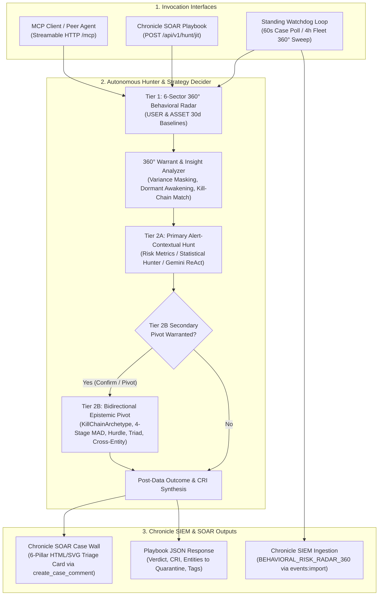

# 🛡️ Agentic UEBA: Autonomous SecOps Threat Hunter & 360° Behavioral Risk Radar

[](README.md) [](LICENSE) [-brightgreen.svg)](tests/)

**Agentic UEBA** (`secops-agentic-hunter`) is an autonomous, dual-interface threat hunting and behavioral risk service for **Google Security Operations (Chronicle SIEM & SOAR)**. It embeds the canonical **`secops-risk-metrics-multistage`** (`v2.1.3+`) and **`secops-statistical-hunter`** (`v2.8.3+`) skills as a unified **Bilateral UEBA Harness** to provide continuous tenant-wide behavioral baselining, automated SOAR case triage with 6-pillar HTML/SVG Case Wall reporting, and Just-In-Time (JIT) playbook and MCP execution.

---

## 🚀 Core Capabilities & Operational Modes

`agentic-ueba` operates across four integrated workflows:

### 1. Standing Fleetwide 360° Behavioral Risk Radar & UDM Event Ingestor
Every **4 hours** (`FLEET_360_INTERVAL_SECONDS=14400`), `WatchdogDaemon` executes a deterministic **Mode A** (today's UTC bucket vs. 30-day baseline) fleetwide sweep across the tenant's entire `USER` and `ASSET` populations via `RiskMetricsEngine.run_fleet_360_sweep()`:
* **$O(1)$ Fleetwide Query Complexity**: Evaluates all entities in 6 decoupled multi-stage YARA-L 2.0 sector queries per entity type:
  * **`USER` Sectors (6)**: `Auth`, `Cloud` (4-family CRUD across read/write/create/delete), `Workspace`, `Egress`, `DNS`, and `Web`.
  * **`ASSET` Sectors (6)**: `Auth`, `Egress`, `DNS`, `Web`, `Flows`, and `Alerts`.
* **Euclidean Threat Distance & Calibrated Risk Index (CRI)**: Computes multi-sector Euclidean distance $D = \sqrt{\sum \max(0, Z_i)^2}$ and Sigmoid-normalized $\text{CRI} \in [0, 100]$.
* **Intra-Day Deduplication (`WatchdogState.should_emit_fleet_360`)**: Tracks emitted `(bucket_date, entity_type, entity_id)` tuples in `data/watchdog_state.json`. An outlier entity ($\ge 1$ sector with $Z \ge 3.0\sigma$) is emitted at most once per UTC day unless:
  1. A **new behavioral sector** breaches $\ge 3.0\sigma$ later in the day, or
  2. Its composite Euclidean distance $D$ **escalates by $\ge +2.0\sigma$**.
* **Native Chronicle UDM Ingestion (`BEHAVIORAL_RISK_RADAR_360`)**: Builds one structured UDM event per outlier entity (`RiskMetricsEngine.build_360_outlier_udm_event()`) and ingests it directly into Chronicle via `IngestionService.ImportEvents` (`scripts.chronicle_ingest.import_events`):
  * **Unbundled Roll-Up Labels (`target.resource.attribute.labels`)**: `Hunt Campaign ID`, `Evaluated Day`, `Composite CRI`, `Composite D`, `Peak Vector`, `Peak CRI`, `Peak Z`, and `Breached Vectors`.
  * **Composite Roll-Up (`security_result[0]`)**: `rule_type = "COMPOSITE_360"`, `risk_score = <Composite CRI>`, `severity = "CRITICAL" | "HIGH" | "MEDIUM" | "LOW"`.
  * **Per-Vector Entries (`security_result[1..N]`)**: One `rule_type = "SECTOR_VECTOR"` entry per non-zero vector sorted descending by $Z$-score, with `threat_name = "<SECTOR>"`, native integer `risk_score = <Vector CRI>`, native float `confidence_score = <Vector Z>`, and `threat_status = "ACTIVE" | "CLEARED"`—enabling direct numeric YARA-L 2.0 rules and SIEM dashboards without regex or string parsing.

---

### 2. Autonomous SOAR Case Scanner, 3-Stage Investigation & Case Wall Triager
Every **60 seconds** (`WATCHDOG_INTERVAL_SECONDS=60`), `WatchdogDaemon` polls open Chronicle SOAR cases (`list_cases`), filters out previously triaged cases via `WatchdogState`, extracts the primary entity (`USER`, `ASSET`, or `IP`) from raw alert connector telemetry (`get_connector_event`), and dispatches unseen cases to a bounded async worker pool (`WATCHDOG_WORKER_CONCURRENCY=3`):
* **Stage 1 — Tier 1 360° Behavioral Risk Radar**: Profiles the entity across all 6 behavioral sectors over a 14-day window (`run_360_behavioral_radar()`), extracting per-sector `$z`, `$obs`, `$avg`, and `$std`. Automatically resolves corporate email addresses (`*@*`, excluding GCP service accounts) to their canonical UDM `user.userid`.
* **Stage 2 — Warrant & Insight Synthesis (`StrategyDecider.analyze_360_insights`)**: Synthesizes active spikes ($Z \ge 2.0$), sub-threshold sectors ($1.25 \le Z < 2.0$), variance-masked sectors ($1.25 \le Z < 3.0$ where $\sigma \ge \max(1.5\mu, 5.0)$), dormant baseline awakenings ($\text{obs} > 0, \mu < 1.0, Z \ge 1.5$), matched MITRE ATT&CK `KillChainArchetype` topologies, and cross-entity bridges (`USER` $\leftrightarrow$ `ASSET`/`IP`).
* **Stage 3 — Tier 2A Primary Hunt & Tier 2B Bidirectional Epistemic Pivot**:
  * **Tier 2A (Alert-Contextual Deep Dive)**: Executes the mathematical model best suited to the triggering alert and 360° radar topology (or runs a bounded Gemini ReAct loop for open-ended hypotheses).
  * **Tier 2B (Agent-Guided Secondary UEBA Investigation)**: When warranted by the 360° radar insights or Tier 2A outcome (`ACUTE_OUTLIER`, `CLEAN_OR_SUBTHRESHOLD`, `SPARSE_BASELINE`, `FLEET_WAVE`), automatically pivots to a second-order investigation:
    * *Confirmed Outliers (`ACUTE_OUTLIER`)* $\rightarrow$ Pivots to kill-chain progression (`KillChainArchetype` multi-stage fusion across 8 MITRE ATT&CK chains, Workspace 3-Stage Triad decomposition, Cloud Repository Scope & caller IP attribution, or Rare Destination Entity Context Graph enrichment).
    * *Refuted / Masked Hypotheses (`CLEAN_OR_SUBTHRESHOLD` / `SPARSE_BASELINE`)* $\rightarrow$ Pivots across mathematical assumptions (4-Stage Non-Parametric `MAD` for heavy-tailed variance masking, `TWO_PART_HURDLE` for dormant baseline awakenings, Cloud `fail`-mode access-denied recon, `MACD_MOMENTUM_VELOCITY`, `CIRCADIAN_VON_MISES`, or Cross-Entity `USER` $\leftrightarrow$ `ASSET` bridges).
* **Case Wall Injection (`CaseWallCardFormatter`)**: Renders a sanitized, SOAR-compatible HTML/SVG 6-pillar forensic triage card and posts it directly to the Chronicle SOAR Case Wall via `create_case_comment`.

---

### 3. Chronicle SOAR Playbook Gateway (REST Webhook)
Chronicle SOAR Playbooks can invoke `agentic-ueba` synchronously via a standard **HTTP Request** action block against `POST /api/v1/hunt/jit`:
* Executes the full 3-stage investigation for the target entity and case.
* Posts the HTML/SVG forensic triage card to the Case Wall (when `post_to_case_wall: true`).
* Records the case in `WatchdogState` so the standing background scanner does not duplicate the triage.
* Returns a machine-readable `JITHuntResponse` JSON payload (`triage.verdict`, `triage.calibrated_risk_index`, `triage.recommended_action`, `triage.entities_to_quarantine`, `triage.tags`, and `clean_hand_off`) for downstream playbook conditional branching and automated containment.

---

### 4. Model Context Protocol (FastMCP Server)
Exposes `/mcp` (Streamable HTTP / SSE) with **18 MCP tools** for Agent-to-Agent (A2A) orchestration, Gemini CLI / IDE integration, and interactive analyst workflows.

---

## 🏗️ Architecture & Execution Flow



---

## 🔌 How to Invoke `agentic-ueba`

### A. REST API Endpoints

#### 1. SOAR Playbook JIT Investigation (`POST /api/v1/hunt/jit`)
```bash
curl -X POST "https://<YOUR_SERVICE_URL>/api/v1/hunt/jit" \
  -H "Content-Type: application/json" \
  -d '{
    "target_entity": "alex.lund@stackedpads.local",
    "entity_type": "USER",
    "case_id": "40192",
    "alert_name": "Suspicious Google Drive Download Volume",
    "alert_description": "User downloaded an anomalous volume of sensitive files from Workspace Drive.",
    "skill": "auto",
    "lookback_days": 14,
    "post_to_case_wall": true
  }'
```

**Response Structure (`JITHuntResponse`)**:
```json
{
  "status": "SUCCESS",
  "case_wall_updated": true,
  "triage": {
    "calibrated_risk_index": 95.0,
    "verdict": "CRITICAL",
    "is_outlier": true,
    "primary_vector": "tier2b:PART_OF_THE_WHOLE_TRIAD_MULTILEVEL",
    "common_vector": "WORKSPACE",
    "second_order_ran": true,
    "tags": ["RISK:CRITICAL", "VECTOR:WORKSPACE", "SECOND_ORDER_HUNT"],
    "top_z_score": 7.85,
    "recommended_action": "QUARANTINE_AND_ESCALATE",
    "entities_to_quarantine": ["alex.lund"],
    "mitre_tactics": ["TA0009", "TA0010"]
  },
  "clean_hand_off": {
    "target_entity": "alex.lund",
    "entity_type": "USER",
    "evaluated_window": "14d",
    "primary_model": "PART_OF_THE_WHOLE_TRIAD_MULTILEVEL",
    "outlier_topology": "MULTI_SECTOR_KILLCHAIN"
  }
}
```

#### 2. On-Demand or Backfill Fleetwide 360° Sweep (`POST /api/v1/radar/fleet-sweep`)
```bash
curl -X POST "https://<YOUR_SERVICE_URL>/api/v1/radar/fleet-sweep" \
  -H "Content-Type: application/json" \
  -d '{
    "entity_types": ["USER", "ASSET"],
    "spike_threshold_z": 3.0,
    "spoke_inclusion_z": 2.0,
    "min_observed": 5,
    "lookback_days": 1,
    "ingest_events": true
  }'
```

#### 3. Autonomous Markdown Hunting Playbooks (`/api/v1/playbooks`)
Point `agentic-ueba` at a public GitHub Markdown URL (e.g., `https://github.com/GooGKush/docs/blob/main/shadow-ai-agentic-ueba-hunting.md`) to automatically normalize the URL to `raw.githubusercontent.com`, extract all multi-stage YARA-L 2.0 `stage` queries, validate them against the Malachite AST validator, schedule periodic searches in parallel waves, and ingest matches as `PLAYBOOK_BEHAVIORAL_HUNT_MATCH` UDM events via `IngestionService.ImportEvents`:
* **Intra-Playbook Wave Concurrency**: Independent upstream queries execute concurrently (`SECOPS_PLAYBOOK_QUERY_CONCURRENCY=3`) before synchronizing at entity-seeded or Capstone barriers.
* **Three Chaining Modes & UDM Indexing Latency**:
  1. **Option 1 — In-DAG Piecewise Unification (0s wait)**: Joins a 30-day `metrics.*` stage and a raw UDM stage inside a single YARA-L 2.0 DAG.
  2. **Option 2 — In-Memory Upstream Candidate Seeding (`/* UPSTREAM_CANDIDATE_IPS */` / `/* UPSTREAM_CANDIDATE_USERS */`, 0s wait)**: Passes candidate entities extracted from Query $N$ in memory directly into Query $N+1$ without waiting for Chronicle UDM indexing.
  3. **Option 3 — Native UDM Loopback & Read-After-Write Indexing Barrier (`PLAYBOOK_BEHAVIORAL_HUNT_MATCH`, 2–22.5m wait)**: Every playbook run generates a globally unique `run_id` (`run_<playbook_id>_<YYYYMMDDTHHMMSSZ>_<uuid8>`) stamped into `metadata.product_log_id`, `metadata.ingestion_labels`, `target.resource.attribute.labels["Run ID"]`, and `security_result[0].detection_fields["run_id"]`, alongside `security_result[0].rule_name = "<playbook_id>:<query_id>"`. Before executing any downstream **Capstone (`PLAYBOOK_BEHAVIORAL_HUNT_MATCH`)** query:
     - `PlaybookRunner` flushes all upstream UDM events in 500-event batches on the `secops-ueba-io` worker thread pool and clears the in-memory payload buffer.
     - It then polls Chronicle UDM search (`verify_udm_run_indexed()`, default `45 attempts × 30s = 22.5 minutes`) scoped strictly to `metadata.product_log_id = "<run_id>"` and `re.regex(security_result.rule_name, "^<playbook_id>:")` until **`indexed_events >= expected_events`**.
     - If only a subset of events has been indexed when the wait budget expires (e.g., `300` of `3,000` events), the downstream Capstone query is blocked (`SKIPPED_INCOMPLETE_UDM_SYNC`) so it never executes prematurely on partial data.

```bash
# Register and start a periodic Markdown playbook (every 4 hours)
curl -X POST "https://<YOUR_SERVICE_URL>/api/v1/playbooks" \
  -H "Content-Type: application/json" \
  -d '{
    "playbook_id": "php2shell-ueba",
    "url": "https://github.com/GooGKush/docs/blob/main/php2shell-ueba-hunting.md",
    "interval_seconds": 14400,
    "ingest_events": true,
    "run_immediately": true
  }'

# Inspect registered playbooks and recent run summaries
curl "https://<YOUR_SERVICE_URL>/api/v1/playbooks"

# Trigger an on-demand single pass
curl -X POST "https://<YOUR_SERVICE_URL>/api/v1/playbooks/run" \
  -H "Content-Type: application/json" \
  -d '{"playbook_id": "php2shell-ueba", "ingest_events": true}'

# Pause or stop a scheduled playbook
curl -X POST "https://<YOUR_SERVICE_URL>/api/v1/playbooks/stop" \
  -H "Content-Type: application/json" \
  -d '{"playbook_id": "php2shell-ueba", "delete": false}'
```

#### 4. Watchdog Control & Case Activity Ledger
| Method | Path | Description |
| :--- | :--- | :--- |
| `GET` | `/healthz` | Cloud Run liveness/readiness check (reports default tenant & watchdog state). |
| `GET` | `/api/v1/watchdog/status` | Returns runtime status, queue depth, active workers, 360° sweep stats, and registered playbooks. |
| `POST` | `/api/v1/watchdog/start` | Starts the background case-polling loop, worker pool, 4h fleet 360° scheduler, and playbook scheduler. |
| `POST` | `/api/v1/watchdog/stop` | Cleanly cancels background polling and worker tasks. |
| `POST` | `/api/v1/watchdog/reset-state` | Clears seen cases and intra-day deduplication state in `data/watchdog_state.json`. |
| `POST` | `/api/v1/cases/scan` | Triggers an immediate single scan pass over open SOAR cases (`{"limit": 5}`). |
| `GET` | `/api/v1/cases/activity` | Returns triaged case ledger filtered by `?timeframe=24h` (`1h`, `24h`, `7d`, `all`) and optional `?tag=RISK:CRITICAL,SECOND_ORDER_HUNT`. |
| `POST` | `/api/v1/playbooks` | Registers, AST-validates, and schedules a Markdown hunting playbook from a GitHub URL or file path. |
| `GET` | `/api/v1/playbooks` | Lists registered Markdown playbooks, query inventory, schedule state, and recent run history. |
| `POST` | `/api/v1/playbooks/run` | Executes an on-demand single pass of a registered or ad-hoc Markdown playbook. |
| `POST` | `/api/v1/playbooks/stop` | Pauses (`delete: false`) or removes (`delete: true`) a registered Markdown playbook. |
| `DELETE` | `/api/v1/playbooks/{playbook_id}` | Deletes a registered Markdown playbook subscription. |

---

### B. MCP Tools (`/mcp`)

Connect any MCP client (Streamable HTTP) to `https://<YOUR_SERVICE_URL>/mcp`. Available tools:

| Category | Tool Name | Purpose |
| :--- | :--- | :--- |
| **Core Orchestration** | `hunt_entity` | Full 3-stage autonomous JIT threat hunt for a `USER`, `ASSET`, or `IP`. |
| | `profile_360_risk` | Decoupled 6-sector 360° behavioral risk radar profile for an entity. |
| | `run_fleet_360_sweep` | Runs the Mode A fleetwide 360° sweep and ingests `BEHAVIORAL_RISK_RADAR_360` UDM events. |
| | `scan_open_cases` | Scans open Chronicle SOAR cases and executes autonomous hunts. |
| | `control_watchdog` | Starts, stops, resets, or queries the background `WatchdogDaemon`. |
| | `get_case_activity` | Queries the triaged case ledger by `timeframe` and `tag`. |
| | `manage_playbook` | Registers, lists, pauses, or deletes a scheduled Markdown hunting playbook from a GitHub URL. |
| | `run_markdown_playbook` | Executes an on-demand pass of a Markdown hunting playbook and ingests matched UDM events. |
| **Hybrid Compiler** | `compile_hunt_pipeline` | Compiles an AST-validated multi-stage YARA-L 2.0 query, Pre-Flight card, and 1-shot probe. |
| | `dispatch_hybrid_handoff` | Dispatches a federated `secops-threat-hunt-handoff-v1` payload to `secops-statistical-hunter`. |
| **Specialized Hunters** | `hunt_cloud_crud` | 30-day baseline Cloud CRUD write surge with companion dimensions. |
| | `hunt_hybrid_enrichment` | Dual-Plane 2-stage macro-baseline + micro-telemetry signature fusion. |
| | `hunt_circadian_von_mises` | Off-hours temporal anomaly detection using a 24-hour circular von Mises clock. |
| | `hunt_macd_momentum` | Instantaneous momentum velocity divergence (`7d` vs. `30d` anchor). |
| | `hunt_c2_jitter` | Robotic C2 beaconing detection via inter-arrival Coefficient of Variation ($CV \le 0.20$). |
| | `hunt_poisson_burst` | Credential spray burst clustering via Poisson Fano Factor dispersion ($F > 4.0$). |
| | `hunt_shannon_entropy` | Obfuscated command line / DGA detection via Shannon character-class entropy. |
| | `hunt_markov_transition` | Rare Living-off-the-Land parent$\rightarrow$child process transitions via Markov 2-gram surprisal. |
| | `hunt_zipfian_rarity` | Rare administrative binary execution in the enterprise Zipfian power-law tail. |
| | `hunt_ewma_burst` | Acute intraday kinetic rate surges via EWMA velocity divergence. |
| | `hunt_impossible_travel` | Supersonic geodesic travel velocity (`math.geo_distance >= 900 km/h`) across consecutive logins. |
| | `hunt_producer_consumer_inversion` | Endpoints shifting from net data consumers to net data producers ($\rho \ge 0.80$ + $Z$-score spike). |

---

## ☁️ Hosting, Sizing & Resource Utilization Guidelines (Cloud Run / Container)

> [!IMPORTANT]
> **`agentic-ueba` is a stateful singleton daemon and MUST NOT be horizontally scaled (`--min-instances=1 --max-instances=1`).** Instead of horizontal replicas, scale **vertically** (`2–4 vCPU`, `2–4 GiB RAM`) and tune the internal async/thread concurrency governors described below.

### Why Horizontal Scaling (`max-instances > 1`) Must Be Disabled
1. **In-Process Concurrency Locks & Local Deduplication Ledger**:
   `WatchdogDaemon` uses in-memory `asyncio.Lock` guards (`_scan_lock`, `_fleet_360_lock`, and per-playbook `_playbook_locks[pb_id]`), an in-memory `_in_flight_case_ids` set, and a thread-safe (`threading.RLock`) local atomic JSON ledger (`data/watchdog_state.json`) to track seen SOAR cases, intra-day `BEHAVIORAL_RISK_RADAR_360` emissions, and `PLAYBOOK_BEHAVIORAL_HUNT_MATCH` UDM deduplication. Running multiple container instances would cause replicas to race on the same open SOAR cases (posting duplicate comments to the Case Wall) and ingest duplicate UDM events into Chronicle.
2. **Global Chronicle API Quota Governor**:
   All background loops (4-hour Fleet 360° sweeps, SOAR Case Wall workers, parallel Markdown Playbooks, and UDM read-after-write indexing validators) share a single process-wide `asyncio.Semaphore` (`SECOPS_MAX_CONCURRENT_UDM_SEARCHES=6`) inside `PipelineRunner.execute_query_via_mcp()`. Horizontal replicas multiply query concurrency against the same Chronicle tenant and risk triggering `HTTP 429RESOURCE_EXHAUSTED` throttling.
3. **Background Scheduler Continuity (`--no-cpu-throttling`)**:
   On Google Cloud Run, if CPU is only allocated during HTTP requests, Cloud Run freezes background `asyncio` tasks (`_run_loop`, `_worker_loop`, `_fleet_360_loop`, and `_playbook_loop`) and `secops-ueba-io` worker threads as soon as an HTTP response finishes. You **must** deploy with **CPU always allocated** (`--no-cpu-throttling`) and **`--min-instances=1`**.

---

### Hybrid Async + Worker ThreadPool Concurrency Architecture
To run up to 14 cyclical Markdown hunting playbooks (150+ multi-stage YARA-L 2.0 queries with 2–22.5 minute Capstone UDM indexing barriers) concurrently alongside SOAR Case Wall triage and 360° fleet sweeps without blocking the event loop or starving worker slots, `agentic-ueba` separates **async network wait states** from **blocking I/O & CPU work**:

1. **Global Chronicle `udm_search` Semaphore (`SECOPS_MAX_CONCURRENT_UDM_SEARCHES=6`)**:
   Caps simultaneous in-flight Chronicle `udm_search` calls across all playbooks, UDM `run_id` indexing lag polls, 360° sector sweeps, and Case Wall workers so tenant QPS limits are never breached.
2. **Parallel Playbook Execution (`SECOPS_PLAYBOOK_CONCURRENCY=6`) & Per-Playbook Locks**:
   Up to 6 distinct Markdown playbooks execute concurrently. Because Chronicle UDM indexing (`ImportEvents` $\rightarrow$ Normalization $\rightarrow$ Indexing $\rightarrow$ Enrichment $\rightarrow$ F1/Mindmeld Stats store) typically takes **2 to 20 minutes**, a playbook waiting at its Option 3 Capstone barrier (`verify_udm_run_indexed()`) spends >99% of that window asynchronously sleeping (`await asyncio.sleep(30)`) while holding **zero** `udm_search` semaphore slots. Setting `SECOPS_PLAYBOOK_CONCURRENCY=6` (or `8` for 12+ playbooks) ensures that 3–4 playbooks parked in a 15-minute UDM indexing wait never starve other playbooks from running their upstream waves. Duplicate triggers of the *same* `playbook_id` immediately return `SKIPPED_CONCURRENT`.
3. **Intra-Playbook Wave Concurrency (`SECOPS_PLAYBOOK_QUERY_CONCURRENCY=3`)**:
   Within each playbook, independent upstream queries fan out concurrently in waves before synchronizing at entity-seeded queries (`is_seeded`) or pre-Capstone UDM flush + `run_id` indexing validation barriers (`is_capstone`).
4. **Dedicated Blocking I/O & CPU Worker ThreadPool (`SECOPS_BLOCKING_IO_WORKERS=4` to `6`)**:
   Offloads synchronous operations (`chronicle_ingest.import_events` 500-event batch uploads over `urllib.request`, Google ADC OAuth token refreshes, Malachite YARA-L AST parsing/validation, and atomic `watchdog_state.json` disk writes) onto background `secops-ueba-io-*` OS threads via `loop.run_in_executor()`.
5. **Pre-Barrier Buffer Release (Memory Hygiene for 3,000–10,000 Row Hunts)**:
   When an upstream wave produces thousands of outlier rows (e.g., 3,000 events $\approx$ 12–15 MiB of structured UDM JSON), `_flush_pending_udm_events()` ships the 500-event batches to Chronicle `ImportEvents` and immediately calls `udm_events_to_ingest.clear()` *before* entering the 22.5-minute `verify_udm_run_indexed()` polling loop—keeping resident RAM flat while playbooks wait for UDM indexing.

---

### Recommended Compute & Resource Utilization Tiers

Choose the sizing profile that matches your active playbook and case triage volume:

| Workload Profile | Active Workloads | vCPU (`--cpu`) | Memory (`--memory`) | Recommended Concurrency Env Vars | Expected Peak Utilization |
| :--- | :--- | :--- | :--- | :--- | :--- |
| **Standard Tier**<br>*(Default)* | • Standing SOAR Case Triage (`3` workers)<br>• 4h Fleetwide 360° Sweep (`USER` + `ASSET`)<br>• **1–4** Markdown Hunting Playbooks | **`2 vCPU`** | **`2 GiB`** | `SECOPS_MAX_CONCURRENT_UDM_SEARCHES=6`<br>`SECOPS_PLAYBOOK_CONCURRENCY=4`<br>`SECOPS_PLAYBOOK_QUERY_CONCURRENCY=3`<br>`SECOPS_BLOCKING_IO_WORKERS=4`<br>`SECOPS_UDM_VALIDATION_MAX_ATTEMPTS=45`<br>`SECOPS_UDM_VALIDATION_POLL_SEC=30` | • **CPU**: 0.4–1.3 vCPU (spikes during AST compile & 500-event UDM batch serialization)<br>• **RAM**: ~650 MiB–1.2 GiB<br>• **Chronicle Search**: $\le 6$ concurrent queries |
| **Full Curated Suite / High-Volume Tier**<br>*(12–14 Playbooks / 3,000+ Row Batches)* | • Standing SOAR Case Triage (`3–4` workers)<br>• 4h Fleetwide 360° Sweep (`USER` + `ASSET`)<br>• **All 12–14** Curated Detections & Threat Hunting Playbooks (~160+ multi-stage queries + Option 3 Capstone UDM loopback barriers) | **`4 vCPU`** | **`4 GiB`** | `SECOPS_MAX_CONCURRENT_UDM_SEARCHES=6`<br>`SECOPS_PLAYBOOK_CONCURRENCY=6`<br>`SECOPS_PLAYBOOK_QUERY_CONCURRENCY=3`<br>`SECOPS_BLOCKING_IO_WORKERS=6`<br>`SECOPS_UDM_VALIDATION_MAX_ATTEMPTS=45`<br>`SECOPS_UDM_VALIDATION_POLL_SEC=30` | • **CPU**: 1.2–2.8 vCPU during overlapping playbook waves, 3,000-row UDM batch flushes, & 360° sweeps<br>• **RAM**: ~1.2 GiB–2.4 GiB (10,000-row columnar stats buffers + concurrent 500-event `ImportEvents` chunks)<br>• **Chronicle Search**: $\le 6$ concurrent queries |

### Baseline Container Settings & Timeout Guidance (All Tiers)
| Resource / Setting | Recommended Value | Rationale |
| :--- | :--- | :--- |
| **Instances** | `min-instances=1`, `max-instances=1` | Strict singleton to preserve deduplication state, per-playbook locks, and prevent duplicate Case Wall / UDM writes. |
| **CPU Allocation** | `2 vCPU` (Standard) / `4 vCPU` (Full Suite) | Prevents thread-pool starvation between the main `asyncio` loop and `secops-ueba-io` worker threads during multi-batch `ImportEvents` uploads. |
| **CPU Throttling** | **Always-On** (`--no-cpu-throttling`) | **Mandatory**: Required so standing 60s case scans, 4h fleet 360° sweeps, and 2–22.5 minute background UDM indexing barrier polls never freeze between HTTP requests. |
| **Memory** | `2 GiB` (Standard) / `4 GiB` (Full Suite) | Headroom for concurrent 3,000–10,000 row columnar stats payloads, 500-event UDM batch builders, and SVG/HTML Case Wall rendering without OOM kills. |
| **Uvicorn Workers** | `1` (Default in `Dockerfile`) | **Must remain `1`**: Single-process async event loop so all HTTP/MCP routes and background loops share the same `WatchdogDaemon` locks, semaphores, and `WatchdogState`. Never pass `--workers > 1` to `uvicorn`. |
| **HTTP Request Timeout** | **`3600s` (`--timeout=3600`)** | **Critical for Option 3 UDM Loopback Playbooks**: Chronicle UDM indexing typically takes **2–20 minutes** after `ImportEvents`. A 10-minute (`600s`) HTTP timeout will sever synchronous `POST /api/v1/playbooks/run` or MCP `run_markdown_playbook` calls mid-barrier. Set `--timeout=3600` (Cloud Run's 60-minute max) for synchronous runs, and prefer **scheduled background execution** (`POST /api/v1/playbooks` with `"run_immediately": false`), which runs inside `_playbook_loop` and is completely independent of HTTP request timeouts. |
| **Staggered Playbook Schedules** | Offset `interval_seconds` (e.g., `14400`, `14700`, `15000`) | When registering 12+ playbooks, staggering intervals by 3–5 minutes prevents simultaneous 3,000-row `ImportEvents` bursts and spreads UDM indexing barrier polls evenly across the 4-hour cycle. |

### Example Cloud Run Deployment Command (Full Curated Playbook Suite)
```bash
# 1. Stage canonical skills into .build/skills and build via Cloud Build
gcloud builds submit --config cloudbuild.yaml .

# 2. Deploy as an always-on singleton service with 3600s timeout and 6 playbook slots
gcloud run deploy secops-agentic-hunter \
  --image "gcr.io/${PROJECT_ID}/secops-agentic-hunter:latest" \
  --region us-central1 \
  --platform managed \
  --min-instances=1 \
  --max-instances=1 \
  --cpu=4 \
  --memory=4Gi \
  --no-cpu-throttling \
  --timeout=3600 \
  --concurrency=20 \
  --set-env-vars="CHRONICLE_PROJECT_ID=gus-sdl,CHRONICLE_CUSTOMER_ID=8cbac5ae-8267-4da7-b405-cdbc6fa3f1d5,CHRONICLE_REGION=us,WATCHDOG_ENABLED=true,FLEET_360_ENABLED=true,SECOPS_MAX_CONCURRENT_UDM_SEARCHES=6,SECOPS_PLAYBOOK_CONCURRENCY=6,SECOPS_PLAYBOOK_QUERY_CONCURRENCY=3,SECOPS_BLOCKING_IO_WORKERS=6,SECOPS_UDM_VALIDATION_MAX_ATTEMPTS=45,SECOPS_UDM_VALIDATION_POLL_SEC=30"
```

---

## ⚙️ Environment Variables Reference

| Variable | Default | Description |
| :--- | :--- | :--- |
| `CHRONICLE_PROJECT_ID` | `gus-sdl` | GCP Project ID bound to the Chronicle tenant. |
| `CHRONICLE_CUSTOMER_ID` | `8cbac5ae-...` | Chronicle Customer UUID. |
| `CHRONICLE_REGION` | `us` | Chronicle regional endpoint (`us`, `eu`, `asia-southeast1`, etc.). |
| `CHRONICLE_MCP_URL` | *(auto-resolved)* | Optional override for `https://chronicle.<region>.rep.googleapis.com/mcp`. |
| `GEMINI_MODEL` | `gemini-3.1-pro-preview` | Primary Vertex AI Gemini model for ReAct synthesis. |
| `GEMINI_FALLBACK_MODELS` | `gemini-3-flash-preview,gemini-2.5-pro,gemini-2.5-flash` | Ordered fallback models on quota/availability errors. |
| `SECOPS_MAX_CONCURRENT_UDM_SEARCHES` | `6` | Global process-wide semaphore capping simultaneous Chronicle `udm_search` calls across all playbooks, UDM indexing validators, 360° sweeps, and case workers. |
| `SECOPS_PLAYBOOK_CONCURRENCY` | `6` | Maximum number of distinct Markdown playbooks allowed to execute in parallel (sized so playbooks parked in 2–22.5m UDM indexing barriers do not starve other playbooks). |
| `SECOPS_PLAYBOOK_QUERY_CONCURRENCY` | `3` | Intra-playbook wave concurrency for independent upstream queries prior to seeded or Capstone barriers. |
| `SECOPS_BLOCKING_IO_WORKERS` | `4` | Worker threads in the `secops-ueba-io` `ThreadPoolExecutor` for offloading synchronous UDM `ImportEvents` ingestion (`6` recommended for Full Suite Tier). |
| `SECOPS_UDM_VALIDATION_MAX_ATTEMPTS` | `45` | Maximum polling attempts in `verify_udm_run_indexed()` before blocking a downstream Capstone query (`45 × 30s = 22.5 minutes`). |
| `SECOPS_UDM_VALIDATION_POLL_SEC` | `30.0` | Seconds between UDM indexing validation probes (`verify_udm_run_indexed()`). |
| `WATCHDOG_ENABLED` | `false` | Auto-starts the standing case scanner, playbook scheduler, and fleet 360° loop on startup when `true`. |
| `WATCHDOG_INTERVAL_SECONDS` | `60` | Polling interval (seconds) for open Chronicle SOAR cases. |
| `WATCHDOG_LIMIT_PER_SCAN` | `5` | Maximum unseen cases enqueued per scan pass. |
| `WATCHDOG_SCAN_LOOKBACK_HOURS` | `4` | Sliding creation-time horizon (hours) when querying open SOAR cases. |
| `WATCHDOG_WORKER_CONCURRENCY` | `3` | Number of parallel async case-investigation workers. |
| `FLEET_360_ENABLED` | `false` | Enables the background 4-hour Mode A fleetwide 360° radar sweep when `WatchdogDaemon` runs. |
| `FLEET_360_INTERVAL_SECONDS` | `14400` | Interval (seconds) between fleetwide 360° sweeps (`14400` = 4 hours). |
| `FLEET_360_SPIKE_THRESHOLD_Z` | `3.0` | Minimum single-sector $Z$-score required to classify an entity as a 360° outlier. |
| `FLEET_360_SPOKE_INCLUSION_Z` | `2.0` | Minimum $Z$-score floor for populating secondary sectors on the entity's 360° profile. |
| `FLEET_360_MIN_OBSERVED` | `5` | Minimum observed event count per sector to suppress low-volume noise. |
| `FLEET_360_MAX_OUTLIERS_PER_SECTOR` | `250` | Macro-rollout circuit breaker cap per sector (skips noisy fleet waves). |
| `FLEET_360_INGEST_EVENTS` | `true` | When `true`, ingests `BEHAVIORAL_RISK_RADAR_360` UDM events via `events:import`. |
| `SKILLS_ROOT` | `/app/skills` | Directory containing `secops-risk-metrics-multistage` and `secops-statistical-hunter` (auto-falls back to `~/projects/` or `~/.gemini/skills/` locally). |

---

## 📂 Repository Structure

```text
agentic_ueba/
├── README.md                           # Operational guide, API reference, & Cloud Run hosting instructions
├── ARCHITECTURE.md                     # Deep-dive system architecture, data contracts, & mathematical models
├── LICENSE                             # Apache 2.0 License
├── Dockerfile                          # Production Python 3.13 container baking in canonical skills
├── cloudbuild.yaml                     # Cloud Build CI/CD pipeline (tests -> skill staging -> image build)
├── requirements.txt                    # Runtime Python dependencies
├── data/
│   └── watchdog_state.json             # Persistent ledger for triaged cases & intra-day 360° emissions
├── scripts/
│   └── build_container.sh              # Stages canonical skills into .build/skills for container packaging
├── src/
│   ├── __init__.py
│   ├── _bootstrap.py                   # Runtime path & virtualenv bootstrapper
│   ├── config.py                       # Multi-tenant configuration & ADC Bearer token generator
│   ├── models.py                       # Pydantic schemas (JITHuntRequest, JITHuntResponse, CleanHandOffPayload)
│   ├── server.py                       # Dual FastMCP (/mcp) + Starlette REST Gateway (/api/v1/*)
│   ├── autonomous_hunter.py            # 3-Stage investigation orchestrator + Gemini ReAct loop
│   ├── strategy_decider.py             # 360° warrant analyzer & Tier 2A -> Tier 2B epistemic pivot router
│   ├── risk_metrics_engine.py          # 30d UEBA engine, Fleet 360° sweep, & BEHAVIORAL_RISK_RADAR_360 ingestor
│   ├── stats_hunter_engine.py          # Inline raw-log statistical engine (C2 CV, Fano, Shannon, Markov, Zipf, EWMA, Impossible Travel, Producer-Consumer)
│   ├── playbook_runner.py              # GitHub Markdown playbook fetcher, wave runner, UDM run_id barrier, & Capstone engine
│   ├── pipeline_runner.py              # Template renderer, Malachite AST validator, global udm_search governor, & IO thread pool
│   ├── query_integrity_gate.py         # Pre-dispatch AST/entity/slot/Data-Table validator & post-execution backend error gate
│   ├── dynamic_protocol_adapter.py     # Runtime SKILL.md protocol adapter with reference offloading
│   ├── federated_bridge.py             # Cross-skill Macro-to-Micro handoff bridge
│   ├── watchdog.py                     # Standing case scanner, worker pool, 4h Fleet 360° & parallel playbook scheduler
│   └── formatters/
│       ├── __init__.py
│       └── case_wall_card.py           # Chronicle SOAR Case Wall HTML/SVG card formatter & sanitizer
└── tests/                              # Unit & contract test suite (91 tests)
    ├── test_engines.py
    ├── test_metric_args.py
    ├── test_playbook_runner.py
    ├── test_protocol_adapter.py
    └── test_watchdog.py
```

---

## 🧪 Local Development & Testing

```bash
# Run the full 91-test unit and schema contract suite
pytest tests/ -q

# Start the server locally on port 8080
uvicorn src.server:app --host 0.0.0.0 --port 8080
```

---

## 📜 License
This project is licensed under the [Apache License 2.0](LICENSE).
```
Copyright 2026 Google LLC

Licensed under the Apache License, Version 2.0 (the "License");
you may not use this file except in compliance with the License.
You may obtain a copy of the License at

    http://www.apache.org/licenses/LICENSE-2.0
```

---
*Created and maintained by Greg Kushmerek for Google Security Operations (Chronicle SIEM & SOAR).*
